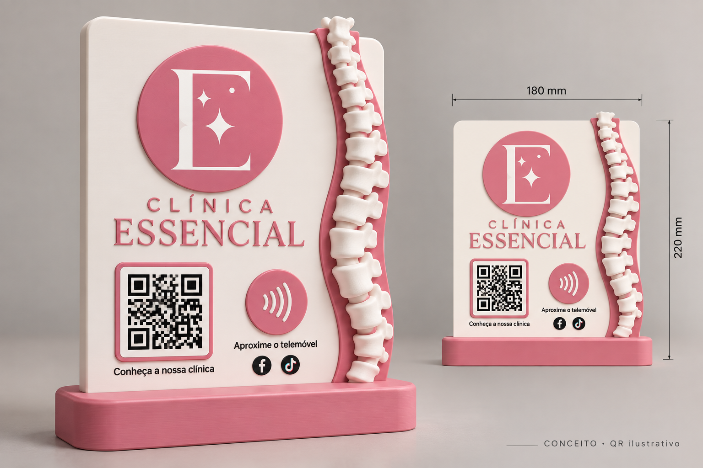

# Clínica Essencial — placa QR e NFC

Projeto de uma placa de balcão para impressão 3D e edição no Autodesk Fusion.

## Ficheiros

- **[M7 — casinha, um protótipo completo A1/AMS, três pratos](downloads/m7-casa-v1-A1-AMS-3-pratos.3mf?raw=true)**
- **[M7 — tijolo Natal 2026, um protótipo completo A1/AMS, quatro pratos](downloads/m7-tijolo-v1-A1-AMS-4-pratos.3mf?raw=true)**
- [M7 — pacote dos dois protótipos: 3MF, STL, Fusion e instruções](downloads/m7-prototipos-v1-pacote.zip?raw=true)
- [M7 — imagem real dos modelos finais](designs/m7-prototipos-v1-CAD.png)
- [M7 — detalhes da frase, logótipos e decoração](designs/m7-prototipos-v1-detalhes.png)
- [M7 — montagem, medidas, consumo e perfis dos protótipos](fusion/M7PrototiposV1/README.md)
- **[M7 — casinha com medidas propostas, vistas de lado e de trás](designs/m7-casa-institucional-v3-medidas.png)**
- **[M7 — casinha, vistas lateral, traseira e peças separadas](designs/m7-casa-institucional-v2-lado-tras-montagem.png)**
- **[M7 — casinha para todo o ano, com frase manuscrita](designs/m7-casa-institucional-conceito-v1.png)**
- [M7 — tijolo Natal 2026, conforme a nova referência](designs/m7-tijolo-natal-2026-conceito-v3.png)
- [M7 — descrição dos dois novos esboços](designs/README-m7-ofertas-conceitos-v3.md)
- **[Universo do Saber V6 — conjunto completo A1/AMS, placa 7 mm e dois pratos sem suportes](downloads/universo-saber-suporte-v6-A1-AMS-2-pratos.3mf?raw=true)**
- [Universo do Saber V6 — pacote Fusion, STL, 3MF e amostras de encaixe](downloads/universo-saber-suporte-v6-pacote.zip?raw=true)
- [Universo do Saber V6 — imagem do CAD final](designs/universo-saber-suporte-v6-CAD.png)
- [Universo do Saber V6 — montagem e contacto com a mesa](designs/universo-saber-suporte-v6-montagem.png)
- [Universo do Saber V6 — instruções, medidas e perfis](fusion/UniversoSaberStandV6/README.md)
- **[Universo do Saber — base reforçada V5, um prato A1/PLA, para usar com as costas V4](downloads/universo-saber-base-v5-reforcada-A1-PLA.3mf?raw=true)**
- [Base V5 — comparação do reforço e janela para carregamento](designs/universo-saber-base-v5-reforcada-comparacao.png)
- [Base V5 — pacote Fusion, STL, 3MF e instruções](downloads/universo-saber-base-v5-reforcada-pacote.zip?raw=true)
- [Base V5 — STL separado](downloads/universo-saber-base-v5-reforcada.stl?raw=true)
- [Base V5 — utilização do cabo, medidas e validação](fusion/UniversoSaberBaseV5/README.md)
- **[Universo do Saber V4 — livros em perspetiva e curva do U aprovada, A1/AMS](downloads/universo-saber-suporte-v4-A1-AMS-2-pratos.3mf?raw=true)**
- [Universo do Saber V4 — pacote completo, Fusion + STL + 3MF](downloads/universo-saber-suporte-v4-pacote.zip?raw=true)
- [Universo do Saber V4 — imagem do CAD final](designs/universo-saber-suporte-v4-CAD.png)
- [Universo do Saber V4 — detalhe dos livros](designs/universo-saber-suporte-v4-livros.png)
- [Universo do Saber V4 — logótipo alinhado](designs/universo-saber-suporte-v4-logo-alinhado.png)
- [Universo do Saber V4 — instruções, medidas e perfil](fusion/UniversoSaberStandV4/README.md)
- **[Universo do Saber V3 — curva corrigida e dois livros, projeto A1/AMS](downloads/universo-saber-suporte-v3-A1-AMS-2-pratos.3mf?raw=true)**
- [Universo do Saber V3 — detalhe dos dois livros](designs/universo-saber-suporte-v3-livros.png)
- [Universo do Saber V3 — logótipo corrigido](designs/universo-saber-suporte-v3-logo-alinhado.png)
- [Universo do Saber V3 — pacote completo](downloads/universo-saber-suporte-v3-pacote.zip?raw=true)
- [Universo do Saber V3 — instruções](fusion/UniversoSaberStandV3/README.md)
- **[Universo do Saber V2 — logótipo suave e alinhado, projeto A1/AMS](downloads/universo-saber-suporte-v2-A1-AMS-2-pratos.3mf?raw=true)**
- [Universo do Saber V2 — logótipo com linhas de alinhamento](designs/universo-saber-suporte-v2-logo-alinhado.png)
- [Universo do Saber V2 — pacote completo](downloads/universo-saber-suporte-v2-pacote.zip?raw=true)
- [Universo do Saber V2 — instruções](fusion/UniversoSaberStandV2/README.md)
- **[Universo do Saber — projeto A1/AMS, dois pratos](downloads/universo-saber-suporte-v1-A1-AMS-2-pratos.3mf?raw=true)**
- [Universo do Saber — pacote completo](downloads/universo-saber-suporte-v1-pacote.zip?raw=true)
- [Universo do Saber — imagem do CAD real](designs/universo-saber-suporte-v1-CAD.png)
- [Universo do Saber — montagem e ângulos](designs/universo-saber-suporte-v1-montagem.png)
- [Universo do Saber — medidas, impressão e teste do encaixe](fusion/UniversoSaberStand/README.md)
- **[Universo do Saber — esboço V3, branco e azul](designs/suporte-universo-saber-conceito-v3-branco-azul.png)**
- [Suporte Universo do Saber V3 — duas cores e livros em contorno](designs/README-suporte-universo-saber-v3.md)
- **[Universo do Saber — suporte desmontável, esboço V2](designs/suporte-universo-saber-conceito-v2.png)**
- [Suporte Universo do Saber — plano de montagem, relevos e cores](designs/README-suporte-universo-saber-v2.md)
- **[Suporte de telemóvel desmontável — esboço V1](designs/suporte-telemovel-encaixe-conceito-v1.png)**
- [Suporte desmontável — plano e medidas propostas](designs/README-suporte-telemovel-encaixe.md)
- **[Marco Cardoso — esboços Natal 2026 V2, tijolo terracota](designs/marco-cardoso-natal-2026-conceitos-v2.png)**
- [Marco Cardoso — propostas, referência do tijolo e estado conceptual](designs/README-marco-cardoso-natal-2026.md)
- **[Topper Joana 12 V3 — Bambu A1 / AMS, quatro cores](downloads/joana-topper-v3-A1-AMS-4-cores.3mf?raw=true)**
- [Topper Joana V3 — pacote Fusion, 3MF, STL e SVG](downloads/joana-topper-v3-pacote.zip?raw=true)
- [Topper Joana V3 — imagem do CAD real](designs/joana-topper-v3-CAD.png)
- [Topper Joana V3 — apoio e hastes em vista frontal/lateral](designs/joana-topper-v3-apoio.png)
- [Topper Joana V3 — instruções e medidas](fusion/JoanaTopperV3/README.md)
- [Topper Joana V3 — script Fusion](fusion/JoanaTopperV3/JoanaTopperV3.py)
- [Topper Joana — V2 anterior preservada](downloads/joana-topper-v2-pacote.zip?raw=true)
- [Topper Joana — V1 anterior preservada](downloads/joana-topper-v1-pacote.zip?raw=true)
- **[Grelha V3 — projeto Bambu Studio A1 / PLA, dois pratos](downloads/grelha-pintos-v3-A1-PLA-2-pratos.3mf?raw=true)**
- [Grelha PLA — mapa dos dois pratos](designs/grelha-pintos-v3-PLA-2-pratos.png)
- [Grelha PLA — configurações e utilização](fusion/GrelhaPintosV3PLA/README-2-pratos.md)
- [Versão anterior — projeto PLA de 13 pratos](downloads/grelha-pintos-v3-A1-PLA-13-pratos.3mf?raw=true)
- **[Grelha para pintos V3 — placa universal + presilhas + amostra](downloads/grelha-pintos-v3-encaixes.zip?raw=true)**
- [Grelha V3 — placa universal STL](downloads/grelha-pintos-v3-placa-universal.stl?raw=true)
- [Grelha V3 — amostra das duas bordas STL](downloads/grelha-pintos-v3-amostra-duas-bordas.stl?raw=true)
- [Grelha V3 — presilha padrão STL](downloads/grelha-pintos-v3-presilha-padrao.stl?raw=true)
- [Grelha V3 — código Fusion](fusion/GrelhaPintosV3/GrelhaPintosV3.py)
- [Grelha V3 — esquema de montagem](designs/grelha-pintos-v3-encaixes.png)
- [Grelha V3 — teste da amostra e instruções](fusion/GrelhaPintosV3/README.md)
- **[Grelha para pintos V2 — versão anterior, sem presilhas](downloads/grelha-pintos-v2.zip?raw=true)**
- [Grelha para pintos V2 — STL 217,3 × 179,8 × 30 mm](downloads/grelha-pintos-v2-217.3x179.8x30.stl?raw=true)
- [Grelha para pintos V2 — código Fusion](fusion/GrelhaPintosV2/GrelhaPintosV2.py)
- [Grelha para pintos V2 — esquema](designs/grelha-pintos-v2-esquema.png)
- [Grelha para pintos V2 — instruções](fusion/GrelhaPintosV2/README.md)
- **[Grelha para pintos V1 — pacote STL + Fusion](downloads/grelha-pintos-v1.zip?raw=true)**
- [Grelha para pintos V1 — STL 217,3 × 179,8 × 30 mm](downloads/grelha-pintos-v1-217.3x179.8x30.stl?raw=true)
- [Grelha para pintos V1 — código Fusion](fusion/GrelhaPintosV1/GrelhaPintosV1.py)
- [Grelha para pintos V1 — esquema](designs/grelha-pintos-v1-esquema.png)
- [Grelha para pintos V1 — instruções e limites do protótipo](fusion/GrelhaPintosV1/README.md)
- **[Base Premium — download separado, encaixe original](downloads/essencial-base-premium.zip?raw=true)**
- [Base Premium — código Fusion](fusion/EssencialBasePremium/EssencialBasePremium.py)
- [Base Premium — medidas e instruções](fusion/EssencialBasePremium/README.md)
- [Base Premium — esquema das medidas](designs/essencial-base-premium-medidas.png)
- **[A1 + avaliações Google — download atual](downloads/essencial-fusion-a1-avaliacoes.zip?raw=true)**
- [A1 + avaliações Google — código Fusion](fusion/EssencialA1Reviews/EssencialA1Reviews.py)
- [A1 + avaliações Google — esquema atualizado](designs/essencial-a1-avaliacoes-esquema.png)
- [Instruções e endereços para programar NFC](fusion/EssencialA1Reviews/README.md)
- **[Bambu A1 — download (link Google ainda provisório)](downloads/essencial-fusion-a1.zip?raw=true)**
- [Bambu A1 — código Fusion](fusion/EssencialA1/EssencialA1.py)
- [Bambu A1 — esquema com dimensões completas](designs/essencial-a1-esquema.png)
- [Bambu A1 — instruções e pendência do link de avaliações](fusion/EssencialA1/README.md)
- **[V4 — download com QR de 64 mm](downloads/essencial-fusion-v4-qr64.zip?raw=true)**
- [V4 — código Fusion](fusion/EssencialV4/EssencialV4.py)
- [V4 — esquema atualizado](designs/essencial-v4-qr64-esquema.png)
- [V4 — dimensões e impressão](fusion/EssencialV4/README.md)
- **[V3 Fast — download da versão otimizada](downloads/essencial-fusion-v3-fast.zip?raw=true)**
- [V3 Fast — código e indicação de progresso](fusion/EssencialV3Fast/EssencialV3Fast.py)
- [V3 Fast — instruções](fusion/EssencialV3Fast/README.md)
- **[V3 — dois QR, símbolos e etiquetas NFC encapsuladas](fusion/EssencialV3/EssencialV3.py)**
- [Download do pacote Fusion V3](downloads/essencial-fusion-v3.zip?raw=true)
- [V3 — esquema frontal](designs/essencial-v3-esquema.png)
- [V3 — instruções de pausa e montagem](fusion/EssencialV3/README.md)
- [Placa Fusion com QR Instagram integrado](fusion/EssencialV2Instagram/EssencialV2Instagram.py)
- [Download: Fusion + STL QR + imagem](downloads/essencial-fusion-instagram.zip?raw=true)
- [STL: pastilha QR independente](downloads/instagram-qr-51mm.stl?raw=true)
- [QR Instagram — imagem](designs/instagram-qr.png)
- [Instruções de impressão e contraste do QR](fusion/README-Instagram.md)
- [Script V2 — duas peças e nova coluna](fusion/EssencialV2/EssencialV2.py)
- [Instruções e medidas do encaixe V2](fusion/EssencialV2/README.md)
- [Download do pacote Fusion V2](downloads/essencial-fusion-v2.zip?raw=true)
- [Script Python para Fusion](fusion/EssencialDraft/EssencialDraft.py)
- [Como executar no Fusion](fusion/README.md)
- [Download do pacote Fusion](downloads/essencial-fusion-draft.zip?raw=true)
- [Desenho conceptual](designs/clinica-essencial-conceito-v1.png)
- [Download do desenho em ZIP](downloads/clinica-essencial-draft.zip?raw=true)

O desenho conceptual mostra a primeira proposta. O script inclui uma alteração
posterior: logótipo a prolongar-se para fora do canto superior esquerdo, com a
mesma espessura da placa. Por isso, a imagem não representa exatamente o CAD.

## Estado do draft

Os **protótipos M7 V1** incluem uma casinha sem Natal, com a frase manuscrita,
e um tijolo Natal 2026 com decoração para colar. Os dois projetos A1/AMS foram
exportados, reabertos e fatiados sem avisos ou suportes: três pratos e 70,69 g
para a casinha; quatro pratos e 39,44 g para o tijolo. Há uma troca de cor na
fachada e nenhuma nos restantes pratos. A geometria e a montagem foram
verificadas; a impressão física, a colagem e a execução do script Fusion
continuam por testar. O pacote inclui os STL, os perfis e as instruções.

O **suporte Universo do Saber V6** é o novo conjunto completo aprovado:
placa branca de 7 mm com bisel mantido, base azul de 6 mm sem bisel inferior
e encaixes de 7,30/6,30 mm. Mantém a janela de carregamento e a travessa de
reforço. Os dois apoios chegam à mesa a 70°. O 3MF A1/AMS foi exportado,
reaberto e fatiado sem avisos: nenhum dos pratos gera suportes, com uma
troca de cor no primeiro e nenhuma no segundo. A estimativa total é 91,51 g
e cerca de 3 h 58 min. É necessário imprimir as duas peças V6; as antigas
V4/V5 não pertencem a este novo encaixe. O script Fusion e a impressão
física da nova versão continuam por testar.

A **base reforçada Universo do Saber V5** é a atualização recomendada para
o prato 2 da V4. Usa as mesmas costas já impressas e mantém o encaixe de
6,30 mm e a folga total de 0,30 mm. Uma travessa frontal de 10 × 6 mm une os
braços e transforma o recorte em U numa janela de carregamento de 18 × 20 mm.
A ficha passa pela janela antes de ser ligada ao telemóvel. O novo 3MF tem
apenas a base, com quatro paredes e 25% gyroid, e foi exportado, reaberto e
fatiado sem avisos: 32,93 g e cerca de 1 h 35 min. A montagem e vários tamanhos
de ficha foram verificados geometricamente; a resistência e o cabo real
ainda precisam de teste físico. As costas V4 não precisam de nova impressão.

O **suporte Universo do Saber V4** integra a segunda proposta aprovada: dois
livros em perspetiva com capas em paralelogramo e lombadas arredondadas, e uma
correção local tangente na curva inferior esquerda do `U`. Mantém as medidas,
as peças do encaixe e os perfis da V3. O 3MF A1/AMS tem dois pratos: uma troca
de cor nas costas e nenhuma na base. Foi exportado, reaberto e fatiado pelo
Bambu Studio oficial sem avisos de fatiamento, com estimativa total de 82,87 g
e cerca de 3 h 42 min. O script ainda não foi executado no Fusion e o encaixe
precisa de teste físico. As versões anteriores ficam preservadas.

O **suporte Universo do Saber V3** remove a pequena quebra que ainda existia
na lateral esquerda do `U`, usando transições tangentes no topo e na curva
inferior. Substitui também os antigos retângulos por dois livros empilhados
em perspetiva, desenhados com contorno de 0,9 mm para o bico de 0,4 mm. O 3MF
nativo foi reaberto e fatiado sem avisos. As versões V1 e V2 ficam preservadas.

O **suporte Universo do Saber V2** mantém as peças e o encaixe da V1, mas
substitui o símbolo perspetivado e facetado por um contorno vetorial suavizado.
A base de `U` e `S` fica horizontal, a lateral longa de `U` fica vertical e a
cabeça passa a ser uma circunferência de alta resolução. O contorno tem 3018
vértices e as curvas do `US` têm passo médio próximo de 0,12 mm. A V1 fica
preservada.

O **suporte Universo do Saber V1** transforma o conceito aprovado num modelo
CAD real de duas peças: costas brancas de 200 × 80 × 6 mm com logótipo,
texto e livros em relevo azul, e base azul de 110 × 80 × 6 mm. O telemóvel
fica a 70° da mesa e dispõe de 171,6 mm úteis acima do apoio. O 3MF nativo
para Bambu A1/AMS tem dois pratos e foi exportado, reaberto e fatiado pelo
Bambu Studio oficial sem avisos: uma troca de filamento nas costas e nenhuma
na base. A folga nominal do encaixe é 0,30 mm; devem ser impressas primeiro
as amostras de 0,20/0,30/0,40 mm. Colisões, percurso de montagem, apoio na
mesa e equilíbrio estático ideal foram verificados por geometria. O script
Fusion e a resistência/estabilidade reais continuam dependentes de um teste
físico.

O **topper Joana 12 V3** acrescenta dourado à escova e à ponta do cabo,
regulariza os topos das letras e usa duas hastes iguais com uma travessa de
apoio no bolo de 88 × 6 × 8 mm. Mantém a base preta contínua. Traduz o
esboço mágico aprovado num relevo de quatro
cores: preto, dourado, castanho e bordô. Mede 180 × 200,3 mm, com base de
2,4 mm e decoração até 3,2 mm; apenas o apoio chega aos 8 mm. Inclui script Fusion com sketches e
extrusões, SVG, STL e um 3MF nativo A1/AMS com as cores atribuídas. O 3MF foi
exportado, reaberto e fatiado com o motor oficial, sem avisos. O script Fusion
e a impressão física ainda não foram executados; consulte as instruções.

O **projeto A1 / PLA** reúne a geometria V3 num único 3MF nativo editável:
um prato com uma placa universal e outro com as 26 presilhas padrão.
Repita o primeiro prato dez vezes para o conjunto 2 × 5. Inclui os mesmos
perfis e ajustes para PLA, mantendo as medidas e a presilha padrão.
As placas usam 0,20 mm, três paredes e 20% gyroid; as presilhas usam 0,16 mm,
quatro paredes e 100% de preenchimento. Os dois pratos foram fatiados na
validação nativa. O encaixe em PLA ainda precisa de teste físico.

A **GrelhaPintosV3** mantém as medidas e as aberturas da V2 e acrescenta oito
encaixes inferiores: dois por lado, sem saliências exteriores. Uma presilha
separada une cada par de encaixes; as bocas exteriores podem ficar vazias.
Há uma amostra de duas bordas e três variantes de presilha PETG para escolher
a retenção antes de imprimir o conjunto. São 26 presilhas para 2 × 5 placas.
A montagem geométrica foi verificada; força e durabilidade precisam de teste
físico. O volume sólido do conjunto, incluindo presilhas, fica cerca de 31,7%
abaixo do original. As versões anteriores ficam preservadas.

O **protótipo GrelhaPintosV2** aumenta as aberturas para **8 × 8 mm**,
tamanho confirmado pelo utilizador após observar o apoio das patas nos 6 mm
do modelo antigo. Conserva o exterior 217,3 × 179,8 mm, altura proposta de
30 mm e redução de 0,2 mm por placa. O volume sólido é cerca de 39,7% menor
que o original. A V1 fica preservada e o novo módulo precisa de teste físico.

O **protótipo GrelhaPintosV1** é um trabalho separado da placa da clínica.
Usa o STL enviado como referência e aplica a redução confirmada de 0,2 mm por
módulo nas duas direções. O conjunto 2 × 5 fica com 434,6 × 899 mm. A altura
proposta é 30 mm, mantendo aberturas de 6 mm. O volume geométrico é cerca de
32,6% menor que a união das cascas do original. Não foi validado com pintos
recém-nascidos nem para cargas físicas; consulte as instruções de utilização
e imprima primeiro um módulo. A placa da clínica e as suas versões ficam preservadas.

A **Base Premium** substitui apenas a base: conserva 160 × 70 × 18 mm,
a ranhura útil 120,6 × 5,5 × 12,8 mm e a entrada alargada original.
Tem cantos R12, bordos superiores exteriores R2 e chanfro frontal de 8 mm,
sem alterar a zona de encaixe. O script é independente e cria um novo documento.

A versão atual **EssencialA1Reviews** mantém a peça completa com **208 × 242 mm**
e os QR de 64 mm. O Google abre o formulário de avaliação com o endereço que
o utilizador confirmou no navegador e no telemóvel. A matriz Google foi
regenerada com correção M para manter módulos de 1,422 mm; as cavidades NFC,
pausa Z=3,8 mm, encaixe e geração otimizada permanecem iguais. Use o mesmo
endereço de avaliações na etiqueta NFC inferior.

A versão anterior **Bambu A1** reorganiza o topo e reduz apenas o círculo do logótipo:
a placa completa, incluindo saliências e língua, fica com **208 × 242 mm**.
Com brim de 5 mm ocupa 218 × 252 mm. Mantém QR de 64 mm, etiquetas, pausa e
encaixe. **O QR Google ainda usa o link de partilha que abre pesquisa; o
endereço direto das avaliações está pendente e não foi substituído por um
endereço presumido.**

A **V4** aumenta os QR para 64 × 64 mm. A placa fica com 200 × 220 mm para
dar espaço aos símbolos, às zonas NFC e à coluna. Mantém a construção
otimizada dos QR, duas peças, as medidas da base/encaixe e a pausa após
Z=3,8 mm. Ambos os QR do esquema descodificam para os mesmos destinos.

A **V3 Fast** mantém a geometria da V3, mas gera os QR em duas extrusões
conjuntas em vez de 628 operações individuais. Inclui cálculo adiado dos
sketches e janela de progresso/cancelamento entre etapas. A igualdade dos
retângulos QR foi verificada; o tempo real no Fusion continua por confirmar.

A **V3** reorganiza a frente em duas linhas: Instagram/Google à esquerda,
respetivo QR no centro e símbolo contactless à direita. Não tem inscrições
“QR”/“NFC”. Mantém duas peças e inclui duas cavidades internas para etiquetas
NFC redondas de 25 mm, a inserir numa pausa após Z=3,8 mm. O E e as estrelas
foram redesenhados com curvas a partir da referência, sem barra central.
O logótipo é uma aproximação manual, não o vetor original. Consulte as
instruções antes de imprimir; ponte do teto, execução no Fusion e leitura
física ainda precisam de validação.

A variante **EssencialV2Instagram** inclui um QR funcional para
`https://www.instagram.com/clinicaessencial_setubal/`, em relevo e unido à
placa. O PNG e a projeção superior do STL foram descodificados para confirmar
o endereço; a impressão física e a execução da variante no Fusion continuam
pendentes. Use módulos pretos sobre fundo branco.

Placa de 180 × 220 × 5 mm, base separada, alojamento traseiro para etiqueta NFC
de 26 mm e zona reservada para QR. Na V2 sem Instagram, o QR não contém um endereço e a
etiqueta NFC tem de ser comprada e programada à parte. Letras são textos de
sketch, não sólidos para impressão. O logótipo é uma aproximação geométrica.

O utilizador confirmou que o script V1 executou no Fusion. A V2 substitui
os blocos por vértebras arredondadas com projeções curvas, tendo em conta um
bico de 0,4 mm. Cria duas peças, cada uma com um corpo sólido: placa e base.
A base tem uma ranhura de 5,5 mm para uma língua de 5 mm, com entrada alargada
e espaço no fundo. A V2 ainda precisa de execução no Fusion e teste físico
do encaixe; o draft não está validado para impressão final.

Os ficheiros entregues ficam neste repositório: scripts em `fusion/`, desenhos
em `designs/` e pacotes em `downloads/`.
