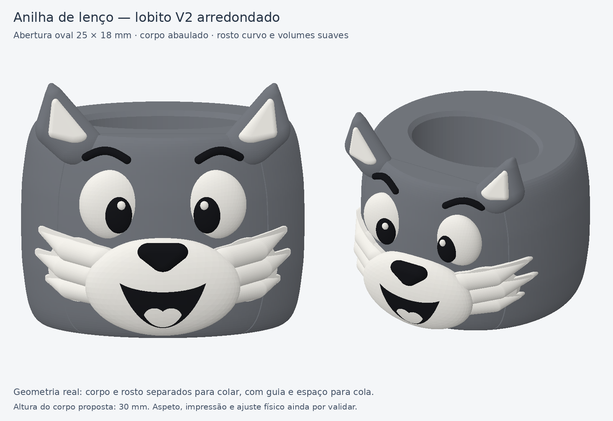

# Anilha do lobito — conceito V2 para aprovação visual

**Estado: conceito arredondado aprovado pelo utilizador.** O pedido posterior
de costas lisas e frente com volume foi aplicado ao
[projeto V3 para imprimir](../downloads/anilha-lobito-v3-costas-lisas-A1-AMS-2-pratos.3mf).

| Elemento | Medida / intenção | Estado |
|---|---|---|
| Passagem interior | Oval **25 × 18 mm**, como na coruja | Medida confirmada pelo utilizador |
| Altura do corpo | **30 mm** | Proposta |
| Largura máxima do corpo | Cerca de **42 mm** | Proposta |
| Altura com orelhas | Cerca de **38 mm** | Proposta |
| Forma exterior | Corpo abaulado, bordos suavizados, rosto curvo | Referências fornecidas |
| Aspeto | Cinzento, branco e preto; olhos, focinho e orelhas com volume | Conceito a aprovar |
| Montagem | Rosto separado para colar, com guia e rebaixo ocultos | Preferência do utilizador |

O objetivo é aproximar o rosto da fotografia original: duas massas de pelo
branco nas bochechas, focinho arredondado, olhos expressivos, sorriso e orelhas
suaves. A união ficará escondida atrás do rosto; o aspeto exterior acompanha
a forma arredondada do corpo.

Os pormenores do encaixe e da impressão estão documentados no projeto V3.
A aprovação visual desta prévia não equivale a teste de ajuste físico ou
de impressão.
