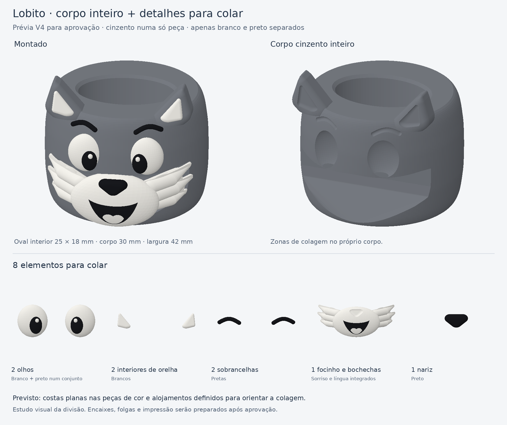

# Anilha do lobito — divisão V4 para aprovação

**Estado: proposta visual; aguarda aprovação.** Esta revisão substitui a
frente cinzenta destacável do V3 por um corpo cinzento completo. Só os
elementos brancos e pretos são preparados à parte para colar.

| Elemento | Quantidade | Construção proposta |
|---|---:|---|
| Corpo e orelhas | 1 | Cinzento, com áreas de colagem no próprio corpo |
| Olhos | 2 | Cada olho já reúne branco, pupila preta e brilho branco |
| Interiores das orelhas | 2 | Brancos |
| Sobrancelhas | 2 | Pretas |
| Focinho e bochechas | 1 | Branco com sorriso preto e língua branca integrados |
| Nariz | 1 | Preto, colado sobre o focinho |

São **um corpo e oito elementos para colar**. Os olhos e o conjunto do
focinho serão impressos em duas cores para evitar a colagem de pupilas,
brilhos e língua individualmente.

Manter a passagem oval **25 × 18 mm** da coruja, corpo abaulado com cerca
de **30 mm de altura e 42 mm de largura**, e cerca de **38 mm até às
orelhas**. Preservar o rosto arredondado da referência.

As peças de cor terão costas planas e volume à frente. O corpo receberá
alojamentos correspondentes para orientar a posição e facilitar a colagem;
o nariz terá apoio no focinho. As profundidades, folgas e superfícies planas
serão detalhadas após aprovação desta divisão.

A imagem reutiliza a escultura anterior para mostrar o aspeto montado e a
distribuição das peças. A vista cinzenta ilustra as zonas a receber os
detalhes; não representa encaixes finais já validados. Nesta revisão não
foram produzidos STL/3MF para imprimir, estimativas de consumo ou validação
física de montagem.
