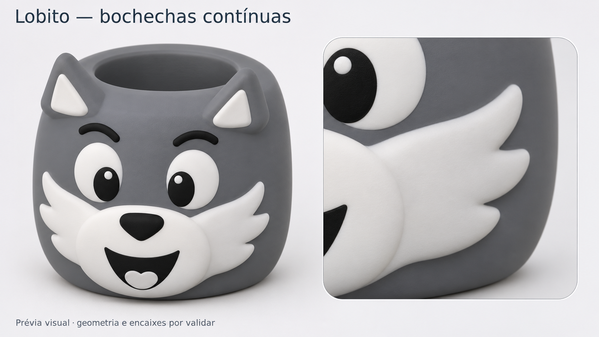

# Lobito V5 — bochechas contínuas e acabamento arredondado

O utilizador pediu a silhueta larga e contínua da primeira fotografia, com
três pontas suaves no contorno das bochechas. A prévia seguinte é uma imagem
de conceito gerada por IA, não uma validação de CAD ou de impressão.

Manter o corpo cinzento inteiro e oito elementos brancos/pretos para colar,
com costas planas. O focinho e as duas bochechas formam um conjunto; os olhos,
o sorriso e a língua não exigem colar pequenos detalhes individualmente.

Após ver a prévia, o utilizador indicou para continuar com as bochechas e
privilegiar a qualidade do arredondado. O projeto será verificado com malha
mais fina, camadas de 0,12 mm e velocidades moderadas nas zonas visíveis.
Os resultados da geometria e do fatiamento serão documentados em
`fusion/AnilhaLobitoV5`, separadamente desta imagem de conceito.

O projeto foi preparado. Consultar a [geometria real](anilha-lobito-v5-bochechas-continuas-CAD.png) e a [documentação de impressão](../fusion/AnilhaLobitoV5/README.md).
