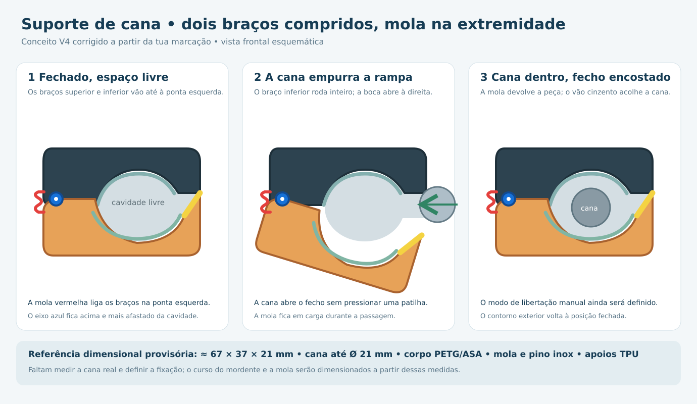

# Suporte de cana — conceito V4 com dois braços compridos

Os dois braços acompanham quase todo o comprimento: o azul é o corpo superior
fixo e o castanho é o mordente inferior móvel. Ambos chegam à extremidade
esquerda, onde ficam ligados pelo conjunto de mola e veio. O veio azul foi
deslocado para cima e para longe da cavidade central. O desenho da mola é
esquemático; o seu tipo e os pontos de apoio serão definidos na modelação.

A cavidade cinzenta fica livre para a cana. Ao empurrar a cana contra a rampa
amarela na direita, o braço inferior roda e abre a entrada. Depois de a cana
passar, a mola fecha o contorno. Falta definir um modo seguro e prático de abrir
manualmente para retirar a cana.

## Medidas propostas, ainda por confirmar

| Elemento | Proposta inicial |
| --- | --- |
| Volume exterior | cerca de 67 × 37 × 21 mm |
| Cana | até Ø 21 mm; medir o diâmetro da cana real no ponto de apoio |
| Corpo e mordente | PETG ou ASA |
| Veio | pino inox Ø 4 mm, provisório |
| Mola | inox; geometria e força dependentes do curso real |
| Contacto com a cana | apoios TPU substituíveis, se houver espaço |
| Fixação | superfície e método por definir |

As medidas exteriores e o Ø 21 mm são apenas uma referência da
[ficha do Big Bud Gen II](https://www.mordonmarine.co.uk/products/big-bud),
sem garantia de que se aplicam à cana e ao local de montagem deste projeto.
Este desenho mostra o movimento pretendido; ainda não é CAD final nem 3MF.
