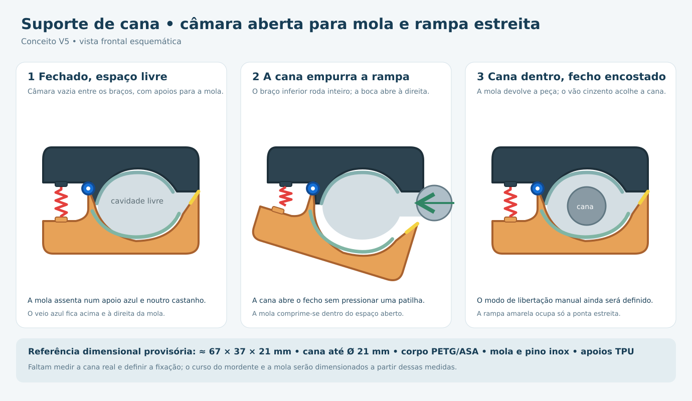

# Suporte de cana — conceito V5 com espaço aberto para a mola

Os braços azul e castanho acompanham o comprimento do suporte. Na extremidade
esquerda existe um espaço vazio **entre os braços**: a mola vermelha apoia-se
numa pequena saliência do braço azul, em cima, e noutra do braço castanho, em
baixo. O veio azul fica acima e à direita da mola. Quando a cana abre o braço
inferior, o apoio inferior sobe e comprime a mola.

A peça amarela ocupa apenas uma faixa estreita da rampa na ponta direita; não
divide o fecho em duas metades. O resto dessa face pertence ao braço castanho.
Depois da entrada da cana, a mola devolve o braço à posição fechada.

## Medidas propostas, ainda por confirmar

| Elemento | Proposta inicial |
| --- | --- |
| Volume exterior | cerca de 67 × 37 × 21 mm |
| Cana | até Ø 21 mm; medir o diâmetro real no ponto de apoio |
| Corpo e mordente | PETG ou ASA |
| Veio | pino inox Ø 4 mm, provisório |
| Mola | mola de compressão inox; diâmetro, comprimento e força a escolher pelo curso necessário |
| Apoios da mola | integrados nos dois braços, com espaço para a mola não raspar nas paredes |
| Contacto com a cana | apoios TPU substituíveis, se houver espaço |
| Fixação | superfície e método por definir |

As medidas exteriores e o Ø 21 mm servem apenas de referência à
[ficha do Big Bud Gen II](https://www.mordonmarine.co.uk/products/big-bud).
O mecanismo, a abertura manual para retirar a cana e as dimensões da mola
precisam de validação antes da modelação final e do 3MF.
