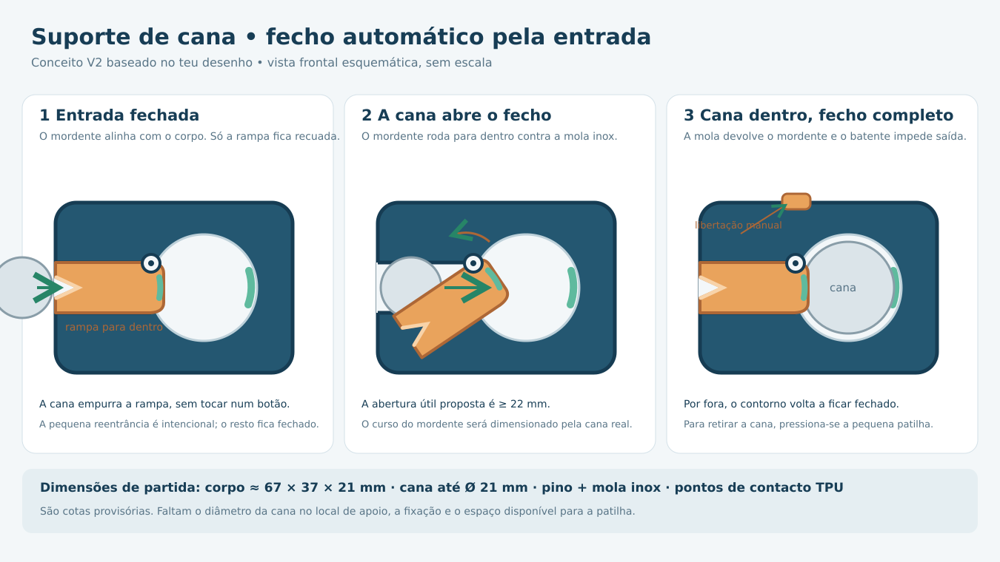

# Suporte de cana com fecho automático — conceito V2

Esta revisão segue o desenho enviado pelo utilizador. A entrada fica
**fechada e alinhada com o contorno exterior**, deixando apenas uma pequena
rampa recuada. Ao empurrar a cana contra a rampa, o próprio cabo roda o
mordente para dentro. Depois de passar, a mola devolve o mordente e a cana
fica cercada por um contorno fechado. Uma patilha acessível permite abrir o
mordente para retirar a cana; o lado interior tem batente para não se abrir
simplesmente por tração para fora.

## Proposta para a modelação

| Elemento | Proposta inicial |
| --- | --- |
| Envelope do suporte | aproximadamente 67 × 37 × 21 mm |
| Cana | até Ø 21 mm; diâmetro mínimo por confirmar |
| Entrada livre com mordente aberto | pelo menos 22 mm, mais folga de ensaio |
| Corpo e mordente | PETG ou ASA, duas peças impressas deitadas |
| Eixo | pino inox A4/316 de Ø 4 mm, dimensão final a selecionar |
| Fecho | mola de torção inox no eixo; curso e força definidos com a mola real |
| Contacto com a cana | apoios substituíveis de TPU |
| Fixação | base plana para fita VHB e furos para parafusos, por escolher |

As medidas exteriores vêm da [ficha atual do Big Bud Gen II](https://www.mordonmarine.co.uk/products/big-bud)
e servem apenas como referência. A forma do fecho é a proposta deste conceito
e será dimensionada a partir da cana e do local de montagem reais.

## Pontos para confirmar

1. O fecho deve abrir **para dentro ao empurrar a cana** e requerer a patilha
   para a retirar, como mostra a imagem?
2. Qual é o diâmetro do cabo no ponto de apoio?
3. Onde será fixado o suporte e preferes fita, parafusos ou ambos?

Este é um desenho de conceito, não uma peça de impressão. Após aprovação,
preparar um modelo paramétrico, uma amostra curta do fecho para teste da
entrada/saída e o projeto 3MF organizado por pratos.
