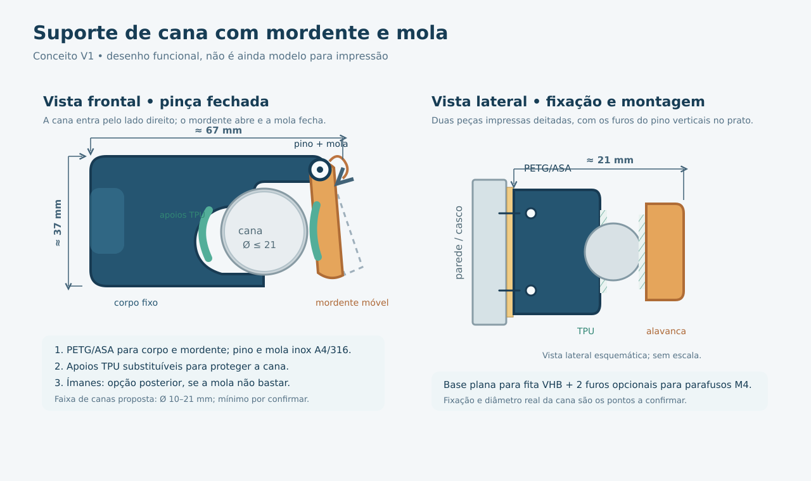

# Suporte de cana com mordente e mola — conceito V1

## Referência observada

O [reel indicado pelo utilizador](https://www.facebook.com/reel/1111578434837933)
identifica o sistema como **Big Bud**, da Mordon Marine, e descreve acolchoamento
interno e mola de aço inoxidável. A [página atual do produto Big Bud Gen II](https://www.mordonmarine.co.uk/products/big-bud)
mostra a pinça e indica 67 × 37 × 21 mm, cana até Ø 21 mm, furo de fixação de
5 mm, PETG e aço inoxidável. Estas são medidas de referência do produto atual,
não cotas verificadas no reel nem medidas do nosso projeto.

## Proposta funcional

- Corpo fixo com encaixe em C, mordente móvel e eixo de aço inoxidável.
- Mola de torção em inox A4/316 no eixo para fechar o mordente quando a cana
  entra pela lateral. A geometria exata da mola fica para depois de escolher
  a peça metálica disponível.
- Dois apoios substituíveis de TPU nas zonas de contacto com a cana.
- Face traseira plana para fita VHB; dois furos opcionais para parafusos M4,
  com vedação adequada se a instalação for num casco.
- Ímanes ficam opcionais após um teste da força de retenção. O produto Gen II
  comercial usa quatro, mas a primeira versão do nosso conceito depende da
  mola e dos apoios TPU.
- Volume alvo aproximado 67 × 37 × 21 mm; intervalo de canas proposto Ø 10–21 mm.
  O valor mínimo é provisório.
- Peças de PETG ou ASA, impressas deitadas; furos do eixo orientados na vertical
  durante a impressão para evitar suportes nessa zona. O conjunto final seria
  entregue em 3MF organizado por pratos depois de aprovar este conceito.

## Pontos a confirmar antes da modelação final

1. Diâmetro do cabo da tua cana **no ponto que ficará preso**.
2. Local de montagem e método pretendido: fita, parafusos ou ambos.
3. Se queres uma única pinça para cana vertical, ou um par para a cana horizontal.

Este ficheiro é apenas um plano de conceito. A resistência da fixação, a força
da mola e o encaixe da cana precisam de teste físico antes de usar no barco.
