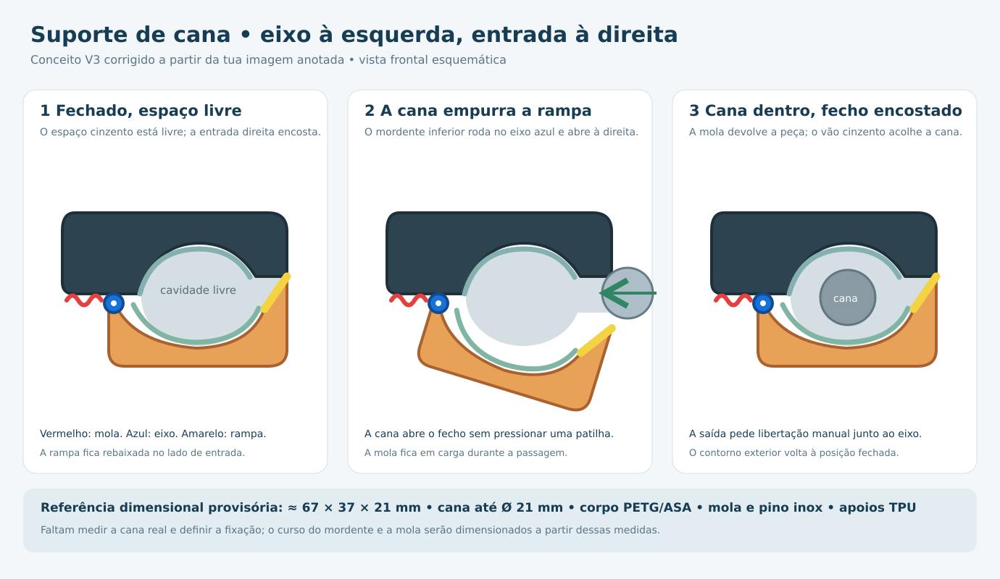

# Suporte de cana — conceito V3 com eixo à esquerda

Esta revisão segue a imagem anotada pelo utilizador:

- **Vermelho:** mola à esquerda do eixo, a fechar o mordente.
- **Azul:** eixo em que o mordente roda.
- **Amarelo:** rampa rebaixada na ponta direita. Ao empurrar a cana contra ela,
  o mordente inferior roda para baixo e liberta a entrada.
- **Cinzento:** cavidade livre para a cana. O mordente acompanha a borda
  inferior da cavidade; não a atravessa quando está fechado.

Depois da entrada, a mola devolve o mordente e a ponta direita encosta ao corpo
fixo. A retirada da cana por tração não deve abrir a rampa pelo lado de dentro.
Propõe-se uma libertação manual acessível junto ao eixo esquerdo; a forma
exata dessa patilha continua em aberto.

## Dimensões e construção propostas

| Elemento | Proposta inicial |
| --- | --- |
| Volume externo | cerca de 67 × 37 × 21 mm |
| Cana | até Ø 21 mm; diâmetro real e mínimo por medir |
| Cavidade e entrada em movimento | recalculadas pela cana real, com folga para apoio de TPU |
| Corpo fixo e mordente | PETG ou ASA, duas peças impressas deitadas |
| Eixo | pino inox A4/316, Ø 4 mm proposto |
| Mola | inox A4/316 à esquerda; tipo e força após escolha de componente real |
| Contacto com a cana | apoios TPU substituíveis na parte superior e no mordente |
| Fixação ao barco | face traseira plana; fita VHB e/ou parafusos a confirmar |

O envelope e o Ø 21 mm vêm da [ficha do Big Bud Gen II](https://www.mordonmarine.co.uk/products/big-bud)
e servem apenas como referência. Esta versão é um conceito, sem geometria CAD de
produção nem ficheiro 3MF. A peça final requer medir o cabo onde será apoiado,
confirmar a superfície de fixação e testar o curso do mordente com a mola
escolhida.
