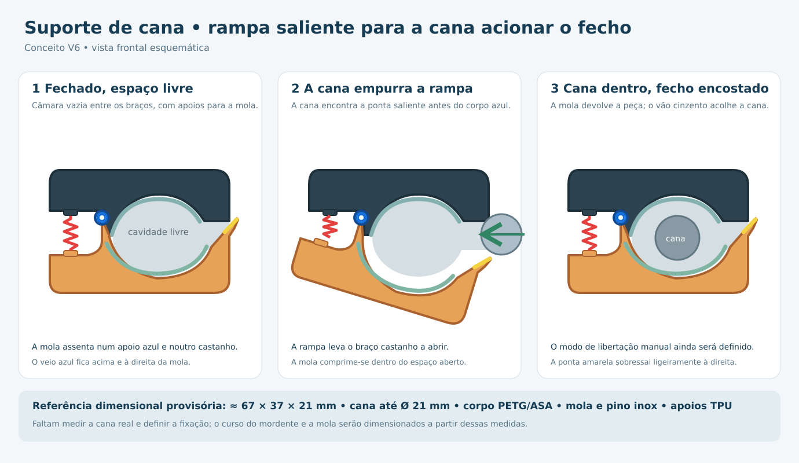

# Suporte de cana — conceito V6 com rampa saliente

A ponta amarela sobressai ligeiramente para a direita do corpo azul. Assim, ao
aproximar a cana, esta encontra primeiro a rampa e transmite o movimento ao
braço castanho. A rampa continua estreita; o braço castanho suporta a carga da
cana. Na peça final, a ponta deverá ser arredondada para não riscar a cana nem
ficar frágil.

O espaço à esquerda continua vazio para a mola de compressão, com um apoio no
braço azul e outro no castanho. O veio fica acima e à direita da mola.

## Medidas propostas, ainda por confirmar

| Elemento | Proposta inicial |
| --- | --- |
| Volume exterior | cerca de 67 × 37 × 21 mm |
| Cana | até Ø 21 mm; medir o diâmetro real no ponto de apoio |
| Saliência da rampa | cerca de 2–3 mm além do corpo azul, a ajustar pelo ensaio |
| Corpo e mordente | PETG ou ASA |
| Veio | pino inox Ø 4 mm, provisório |
| Mola | inox; diâmetro, comprimento e força dependem do curso do mordente |
| Fixação | superfície e método por definir |

As medidas exteriores e o Ø 21 mm são apenas referência à
[ficha do Big Bud Gen II](https://www.mordonmarine.co.uk/products/big-bud).
O conceito precisa de validação visual, definição da abertura manual e teste
do curso antes do CAD final e do 3MF.
