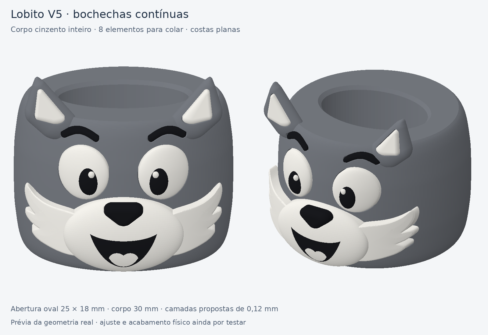

# Anilha do lobito V5 — bochechas contínuas

Corpo cinzento completo, com orelhas integradas. As bochechas brancas têm uma
superfície contínua e três pontas arredondadas no contorno. O focinho e as duas
bochechas constituem um único elemento; o sorriso e a língua já pertencem a
esse conjunto. Os olhos também já incluem pupilas e brilhos.



## Ficheiros

- [Projeto Bambu A1 / AMS — 3 pratos](../../downloads/anilha-lobito-v5-bochechas-continuas-A1-AMS-3-pratos.3mf)
- [Pacote com projeto, STL, scripts e documentação](../../downloads/anilha-lobito-v5-bochechas-continuas-pacote.zip)
- [Alojamentos no corpo](../../designs/anilha-lobito-v5-bochechas-continuas-encaixe.png)
- [Distribuição dos pratos](../../designs/anilha-lobito-v5-bochechas-continuas-pratos.png)
- [Revisão dos percursos do corpo](../../designs/anilha-lobito-v5-bochechas-continuas-percursos.png)

A imagem `anilha-lobito-v5-bochechas-conceito.png` é uma prévia gerada por IA.
As imagens terminadas em `CAD`, `encaixe` e `pratos` mostram a geometria
exportada; `percursos` deriva do G-code do Bambu.

## Medidas e montagem

| Parâmetro | Valor | Origem |
|---|---:|---|
| Passagem oval | 25 × 18 mm | Interior da coruja indicado pelo utilizador como adequado |
| Altura do corpo | 30 mm | Dimensão do conceito |
| Largura máxima do corpo | 42 mm | Dimensão do conceito |
| Altura com orelhas | Cerca de 37,65 mm | Geometria exportada |
| Folga lateral dos alojamentos | 0,18 mm por lado | Proposta para colagem |
| Espaço no fundo para cola | 0,15 mm | Proposta para colagem |

Um corpo cinzento e **oito elementos para colar**: dois olhos, dois interiores
de orelha, duas sobrancelhas, um conjunto focinho/bochechas e um nariz. São
12 STL de material, porque os olhos e o focinho têm branco e preto. No 3MF,
esses materiais já estão agrupados e alinhados em cada peça. Não separar nem
pousar individualmente no prato as pequenas regiões de pupila, brilho ou língua.

Todas as oito peças têm costas planas. Os seus alojamentos têm fundo plano e
um contorno correspondente. O corpo e o nariz não têm pinos. O nariz assenta
no alojamento do focinho; os restantes elementos assentam no corpo.

Remover os apoios do corpo e limpar os alojamentos. Fazer a montagem a seco,
sem forçar. Colar os elementos nos fundos dos alojamentos, com pouca cola.
Colar o nariz no focinho depois de confirmar a posição do conjunto branco.
As folgas são nominais: o encaixe físico deste novo conjunto ainda não foi
testado.

## Impressão e acabamento

Preparado para **Bambu Lab A1, nozzle de 0,4 mm, PLA e prato PEI texturado**.
Os três perfis são PLA genérico, com rácio de fluxo do perfil original; não
foi aplicado o valor calibrado do laranja do tijolo. Selecionar/mapear os
filamentos efetivamente usados e manter a calibração dinâmica de fluxo da A1.

- Camadas de **0,12 mm**, primeira camada de 0,20 mm.
- Parede exterior até **30 mm/s**; superfícies superiores até **20 mm/s**.
- Velocidades em balanço também limitadas: 30 / 25 / 15 / 10 mm/s;
  pontes a 25 mm/s.
- Aceleração exterior/superior 800 mm/s², restante processo 1000 mm/s².
- Três paredes, 15% de infill Gyroid, seis camadas superiores e cinco inferiores.
- Malha de curvas fina; superfícies esculpidas refinadas a cerca de 0,25 mm
  antes da deformação. Simplificação de exportação de 0,001 mm.
- Sem ironing e sem brim nos objetos. A torre de purga mantém a sua base.
- Apoios árvore no corpo para os alojamentos e balanços; peças de cor sem apoios.
- Costas das oito peças de cor diretamente no prato; superfícies arredondadas
  voltadas para cima. O corpo imprime de pé, com passagem do lenço na vertical.

As camadas de 0,12 mm favorecem o arredondado. A largura de extrusão continua
adequada ao nozzle de 0,4 mm; não foram usadas linhas excessivamente estreitas
para tentar obter suavidade. A resolução de fatiamento é 0,006 mm. A impressão
FDM continua a ter camadas visíveis, sobretudo sob luz rasante.

## Estimativas do Bambu Studio

| Prato | Conteúdo | Tempo | Material com purgas |
|---|---|---:|---:|
| 1 | Corpo cinzento | 2 h 31 min | 15.90 g |
| 2 | Olhos, focinho/bochechas e orelhas | 2 h 13 min | 21.95 g |
| 3 | Nariz e sobrancelhas | 0 h 12 min | 0.22 g |

Total: cerca de **4 h 56 min e 38,1 g**, incluindo purgas e torre. O prato 2
usa apenas branco/preto e tem 35 trocas de filamento; os outros não têm trocas.
Os três pratos foram fatiados sem avisos no Bambu Studio **02.08.02.61**.
As estimativas mudam com os perfis e as opções selecionadas na máquina.

## Validação

Os scripts verificam superfícies fechadas, corpo unido, passagem interior
livre, costas planas e ausência de colisões entre módulos. O projeto nativo é
reaberto e todos os pratos são fatiados. Os materiais de cada conjunto são
verificados também pela transformação relativa no 3MF, para detetar um
possível desalinhamento de cores. O G-code é revisto incluindo arcos, alturas
de camada, velocidades e posição dos apoios em relação à passagem oval.

Consultar `geometry.json`, `bambu-validation.json` e `toolpath-review.json`
para resultados, estimativas e versão efetivamente usada do Bambu Studio.
A preparação utiliza scripts paramétricos de malha com manifold3d; não é um
documento Fusion/F3D executado. Nenhuma impressão foi enviada à máquina.
A qualidade física, a remoção dos apoios e o ajuste final precisam de um
primeiro exemplar.

## Reproduzir

Com as dependências numpy, scipy, trimesh, manifold3d, Pillow e OpenCV:

```bash
python fusion/tools/generate_anilha_lobito_v5.py
python fusion/tools/build_anilha_lobito_v5.py --bambu-bin /caminho/bin/bambu-studio --work-dir /pasta/de/trabalho
python fusion/tools/check_anilha_lobito_v5_toolpaths.py --validation /pasta/de/trabalho/slice/validation.3mf
```

O construtor usa os perfis completos distribuídos com o executável indicado.
O caminho de bibliotecas Linux em `LD_LIBRARY_PATH` deve ser adaptado ao
ambiente local. Estes scripts não iniciam impressões físicas.
