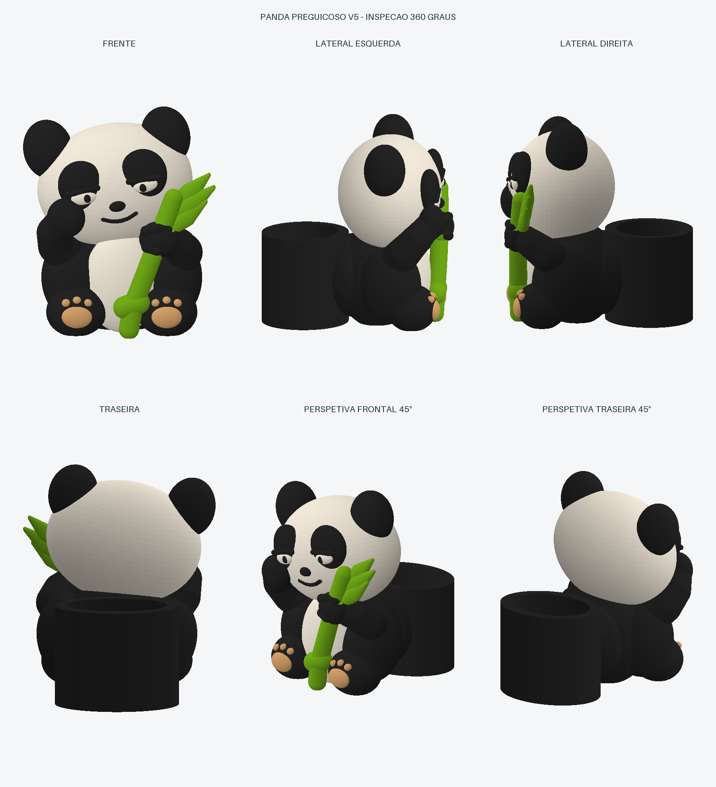

# Panda Preguiçoso V5 — reconstrução premium

Esta versão reconstrói os dois braços e as patas a partir da V4. O braço da
bochecha segue uma curva contínua desde o ombro; a pata toca realmente a face.
O braço direito termina numa palma vazada em torno do bambu e dois dedos
envolvem o caule, evitando a aparência de esfera colocada sobre o bambu.

Mantidos: expressão preguiçosa V4, inclinação da cabeça, quatro cores e tubo
traseiro vertical com passagem útil de 25 × 18 mm e altura de 25 mm.

## Exportação

O 3MF contém quatro objetos nas mesmas coordenadas e quatro materiais base:
preto, branco/creme, verde e bege. Não contém um perfil de impressão inventado.
A versão pronta para importar está em
[`downloads/anilha-panda-preguicoso-v5-Snapmaker-U1-4-cores.3mf`](../../downloads/anilha-panda-preguicoso-v5-Snapmaker-U1-4-cores.3mf).
A importação no slicer Snapmaker e a atribuição às quatro cabeças continuam a
ser verificações obrigatórias, porque o nozzle e o perfil U1 não foram fornecidos.

## Estado técnico

- Malhas fechadas, orientação consistente e conjunto conectado.
- Passagem do lenço preservada em 25 × 18 mm.
- Folhas com espessura mínima desenhada de 3,1 mm.
- Envelope total de 48,06 × 52,54 × 56,41 mm.
- Quatro volumes de cor sem interseções volumétricas entre si.
- Escala em milímetros declarada dentro do 3MF.
- Arquivo 3MF reaberto e conteúdo ZIP verificado sem erros.
- Ajuste do lenço e impressão física ainda não testados.
