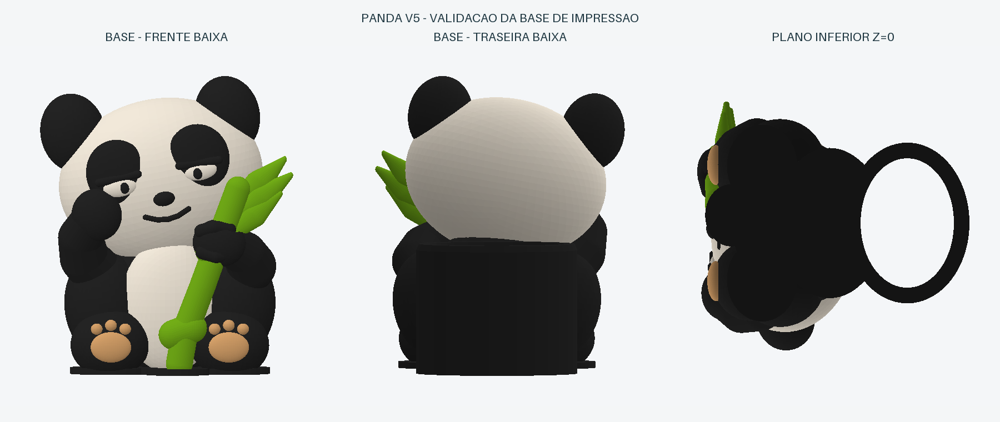

# Panda Preguiçoso V5 — reconstrução premium

Esta versão reconstrói os dois braços e as patas a partir da V4. O braço da
bochecha segue uma curva contínua desde o ombro; a pata toca realmente a face.
O braço direito termina numa palma vazada em torno do bambu e dois dedos
envolvem o caule, evitando a aparência de esfera colocada sobre o bambu.

Mantidos: expressão preguiçosa V4, inclinação da cabeça, quatro cores e tubo
traseiro vertical com passagem útil de 25 × 18 mm e altura de 25 mm.

As patas foram corrigidas para terem, cada uma, uma almofada oval grande e três
almofadas redondas pequenas. Todas são sólidos positivos bege com cúpula
saliente e uma única interface traseira plana em Y=-17,75 mm. O mesmo sólido
recorta a pata preta, criando uma fronteira de cor exata, sem bleed ou caudas.

A zona inferior usa agora uma base técnica preta contínua de 1,2 mm, recuada
dentro da silhueta. Patas, corpo, bambu e manga traseira ficam ligados na
primeira camada; o creme e o verde começam apoiados a Z=1,2 mm. As cúpulas bege
são limitadas à face frontal das patas, impedindo resíduos na zona traseira.
O tubo conserva a passagem nominal de 25 × 18 mm e recebe um chanfro de 1,2 mm
apenas na borda superior, exterior e interior. A borda inferior não tem chanfro.

## Exportação

O 3MF contém um conjunto multipartes com quatro corpos selecionáveis nas mesmas
coordenadas e quatro materiais base: preto, branco/creme, verde e bege. A cor é
registada no corpo e nos triângulos; os metadados Orca associam as quatro partes
aos extrusores 1–4. Não contém um perfil de impressão inventado.
A versão pronta para importar está em
[`downloads/anilha-panda-preguicoso-v5-Snapmaker-U1-4-cores.3mf`](../../downloads/anilha-panda-preguicoso-v5-Snapmaker-U1-4-cores.3mf).
A importação no slicer Snapmaker e a atribuição às quatro cabeças continuam a
ser verificações obrigatórias, porque o nozzle e o perfil U1 não foram fornecidos.

## Estado técnico

- Malhas fechadas, orientação consistente e conjunto conectado.
- Passagem do lenço preservada em 25 × 18 mm.
- Chanfro de 1,2 mm apenas no topo do tubo; base inferior plana em Z=0.
- Folhas com espessura mínima desenhada de 3,1 mm.
- Envelope total de 48,06 × 52,54 × 56,41 mm.
- Quatro volumes de cor sem interseções volumétricas entre si.
- Duas almofadas ovais e seis pequenas reabertas como volumes positivos bege.
- Corpo bege com exatamente oito componentes legítimos; nenhum microfragmento.
- Uma única região de contacto na primeira camada, com 1024,29 mm².
- Plano inferior comum em Z=0 e base técnica com 1,2 mm de altura.
- Zona inferior desenhada para impressão direta sem suportes.
- Escala em milímetros declarada dentro do 3MF.
- Os quatro corpos foram extraídos do 3MF, reabertos e confirmados watertight.
- Conteúdo ZIP verificado sem erros.
- Ajuste do lenço e impressão física ainda não testados.
