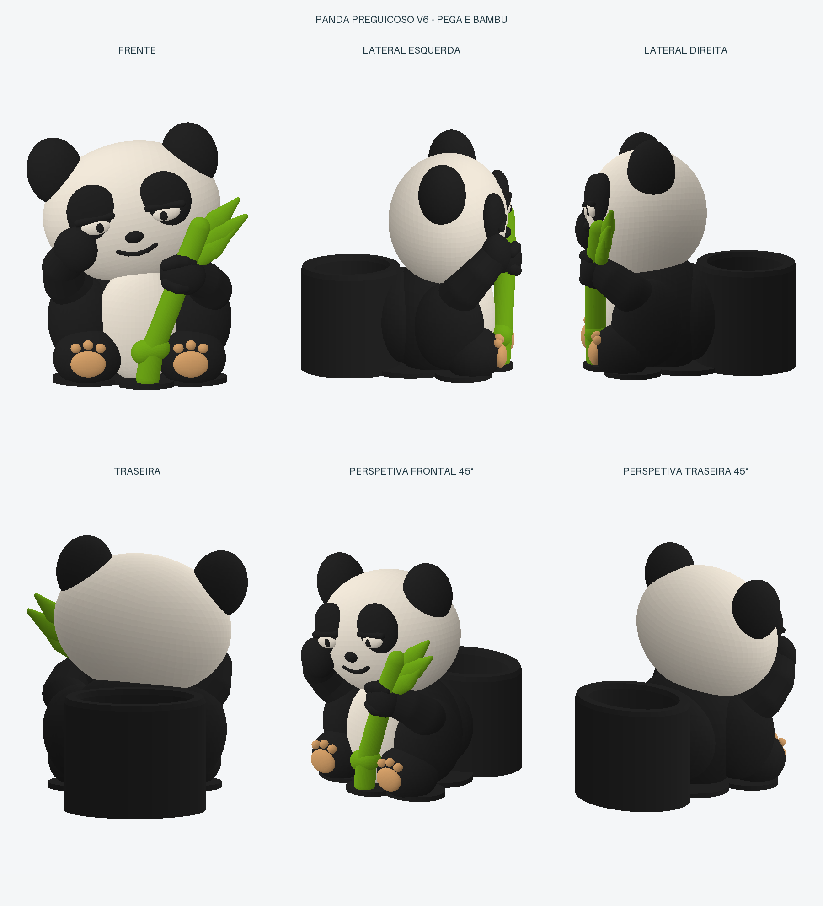

# Panda Preguiçoso V6 — correção localizada da pega

A V6 deriva diretamente da V5 e altera apenas a mão direita e o bambu. A V5
permanece preservada em `fusion/AnilhaPandaU1V5` e no respetivo 3MF.

## Alterações

- Canal da palma reduzido de 2,72 para 2,52 mm para eliminar a exposição verde
  indevida entre os dedos.
- Dedos ligeiramente curvos, afunilados e com transições mais suaves.
- Caule com curvatura e conicidade discretas; região da pega preservada.
- Nós menos volumosos e folhas com pequenas variações de direção e comprimento.
- Restante panda, almofadas, base e tubo traseiro inalterados.

## Exportação

O 3MF V6 mantém um conjunto multipartes com quatro corpos selecionáveis:
preto, creme, verde e bege.

[`downloads/anilha-panda-preguicoso-v6-Snapmaker-U1-4-cores.3mf`](../../downloads/anilha-panda-preguicoso-v6-Snapmaker-U1-4-cores.3mf)

## Validação geométrica

- Interseção volumétrica preto–verde: 0 mm³.
- Verde: um único componente, sem fragmentos isolados.
- Quatro corpos watertight, orientação consistente e sem faces duplicadas.
- Conjunto completo conectado e passagem traseira preservada em 25 × 18 mm.
- Preview no Snapmaker Orca não executado neste ambiente.
