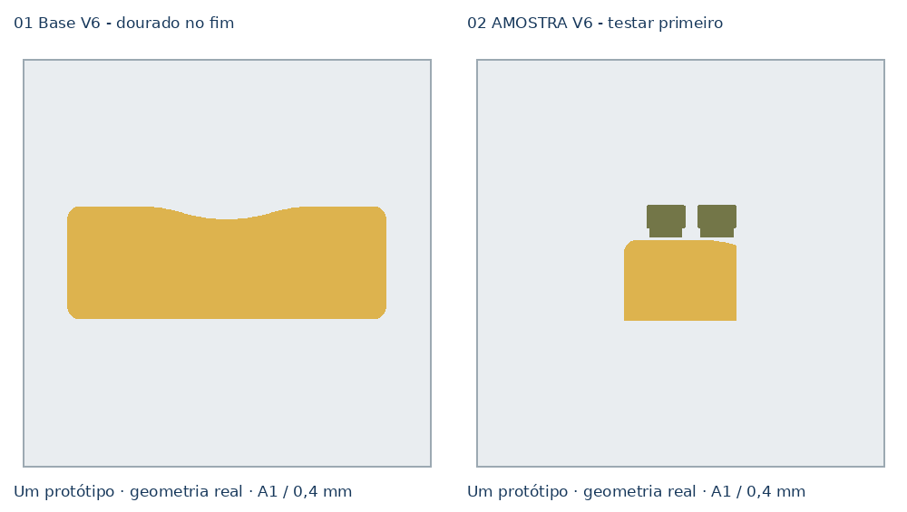
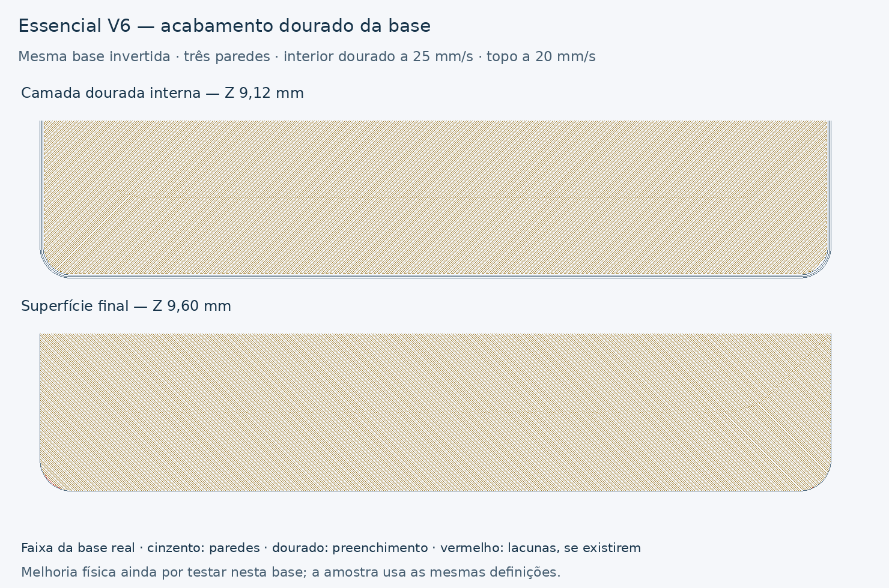

# Clínica Essencial — V6, acabamento da base e amostra

[Descarregar projeto Bambu A1 / AMS — dois pratos](../../downloads/essencial-compacto-v6-base-acabamento-A1-AMS-2-pratos.3mf)

[Pacote com projeto, documentação e imagens](../../downloads/essencial-compacto-v6-base-acabamento-pacote.zip)

Revisão de processo da **base e amostra do compacto V5**, confirmado pelo
utilizador. Conserva a geometria aprovada e transfere o que foi útil no teste
M7 V6 para uma peça estrutural: preenchimentos regulares, velocidades mais
baixas no dourado e a calibração do mesmo dourado Amazon Basics Silk.

Não reduz a base a uma parede: **mantém três paredes e 15% Gyroid**. A frente
com os QR e o fundo nervurado continuam a ser os do projeto V5; não foram
redesenhados nem incluídos como pratos de impressão nesta revisão da base.

## O que foi encontrado na V5

A superfície dourada ampla **já usava linhas a 20 mm/s**. Portanto, a imagem
não demonstra o mesmo mecanismo das pequenas ilhas triangulares da árvore.
Na base V5, o G-code mostrou os preenchimentos dourados inferiores/internos
a cerca de **81 mm/s** e as paredes interiores a cerca de 75 mm/s.

Ver [evidência do fatiamento original](baseline-review.json). A fotografia
mostra irregularidade de textura junto ao canto, mas não estabelece a causa.
O objetivo da revisão é melhorar a consistência, não afirmar que o problema
fica resolvido sem um novo ensaio.

## Configuração V6

| Elemento | V5 | Revisão V6 |
|---|---|---|
| Paredes estruturais | 3 | **3, conservadas** |
| Preenchimento estrutural | 15% Gyroid | **15% Gyroid, conservado** |
| Camada | 0,16 mm | 0,16 mm |
| Fluxo dourado | 0,98 | **0,9702**, calibração usada no M7 |
| Bico dourado | 220 °C | **215 °C**, como no M7 |
| Paredes douradas | 35 exterior / cerca de 75 interior no G-code | **25 mm/s** |
| Preenchimentos dourados por baixo do topo | Cerca de 81 mm/s no G-code | **25 mm/s** |
| Superfície final dourada | 20 mm/s | **20 mm/s, conservada** |
| Topo/fundo dourado | Padrões anteriores | `monotonicline` |
| Interior sólido | Padrão anterior | `monotonic` |
| Conversão automática dos interiores estreitos | Ativa | **Desativada** |
| Camadas superiores da parte dourada | 5 / 0,80 mm | **6 / 0,96 mm** |

As alterações de material são apenas no slot dourado. Os outros rácios de
fluxo continuam nos valores do projeto V5. A base mantém Classic, costura
Front, aceleração exterior de 1000 mm/s², camadas inferiores e pontes a
20 mm/s. Os parâmetros de velocidade dourados são substituições por parte;
o preenchimento sólido em linhas e a deteção de zonas estreitas são opções
de processo deste projeto de dois pratos.

A figura mostra uma faixa de 40 mm de profundidade da base real, com os
percursos recortados nessa faixa. As direções podem alternar entre camadas.
Não é uma previsão fotográfica do brilho ou da textura que ficará no Silk.

## Orientação e compatibilidade

**Mantém-se a orientação invertida da V5.** Durante a impressão, a face verde
encosta ao prato; o dourado fica virado para cima e é feito no fim. Depois
de virar para montar, essa face dourada fica por baixo. Não voltar a inverter
as peças no fatiador.

Base de **200 × 70 × 9,60 mm**, dourado de 0,96 mm, mesma forma plana, recorte
frontal e cantos da V5. As ranhuras de 3,60 mm e os encaixes anteriores não
foram alterados. As placas V4/V5 continuam geometricamente compatíveis.

Os ficheiros dos componentes `3D/` foram preservados byte a byte. Só o bloco
de montagem do modelo principal foi alterado para selecionar os antigos
pratos 3/4, agora 1/2, e transladá-los às novas posições de prato, sem rodar.
As malhas locais de todos os componentes de impressão foram comparadas com
a V5 por vértices e índices de triângulos.

## Abrir, testar e imprimir

Abrir o 3MF **como projeto**. Slots: 1 branco, 2 verde-azeitona, **3 dourado**,
4 preto; neste ficheiro só são usados os slots **2 e 3**. A1, bico de 0,4 mm,
PEI texturado. **Sem brim nem suportes**, com torre de preparação e uma troca
verde → dourado em cada prato.

| Prato | Conteúdo | Tempo estimado | Material incluindo purgas/torre |
|---|---|---:|---:|
| 1 | Base completa | **5 h 45 min** | **70,93 g** |
| 2 | **Amostra — começar por aqui** | **1 h 56 min** | **23,10 g** |

A amostra é o canto real de 70 × 50 mm já definido na V5, com finais de
ranhuras e duas linguetas. Permite comparar a superfície dourada com o
ensaio anterior e verificar a montagem a seco. A geometria não mudou, mas
o ensaio não substitui a avaliação do empeno da base de 200 mm.

As velocidades mais baixas aumentam o tempo: na mesma versão do Bambu, a
base V5 estimava 4 h 26 min e a amostra 1 h 36 min. É uma escolha de
acabamento, ainda por confirmar fisicamente. Manter a calibração dinâmica
ativa como nos testes anteriores.

## Validação

Bambu Studio **02.08.02.61**, dois pratos fatiados sem avisos. Confirmados:
60 camadas de 0,16 mm, 54 verdes seguidas de seis douradas, dourado apenas de
Z=8,80 a 9,60 mm, paredes interiores presentes, todos os percursos dourados
até 25 mm/s e topo final a 20 mm/s. As pontes das ranhuras continuam presentes,
incluindo Z=6,56 mm, com velocidade máxima de 20 mm/s.

[Relatório completo](bambu-validation.json).
[Script de construção](../tools/build_essencial_compacto_v6_base_3mf.py).

O acabamento, o encaixe físico e a leitura dos QR no conjunto não foram
ensaiados pelo agente. Nenhuma impressão foi iniciada. Esta revisão altera
o processo da base; não altera a geometria nem o conteúdo dos QR existentes.
