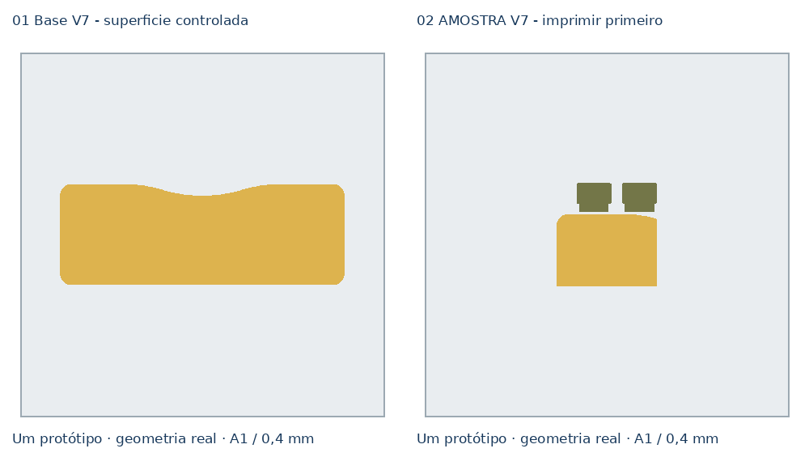

# Clínica Essencial — V7, teste de superfície

[Descarregar projeto Bambu A1 / AMS — dois pratos](../../downloads/essencial-compacto-v7-superficie-controlada-A1-AMS-2-pratos.3mf)

Revisão de processo da base V5/V6. A geometria, dimensões, encaixes e
orientação invertida mantêm-se: 200 × 70 × 9,60 mm, três paredes e 15% Gyroid.

Não usa brim nem suportes, porque a primeira camada física ficou plana e
aderente. A revisão visa a faixa rugosa observada na superfície, não uma
deformação da base.

## Alterações

- O volume verde deixa de fechar uma superfície superior em Z=8,64 mm.
- O dourado conserva seis camadas densas, de Z=8,80 a 9,60 mm, e torna-se a
  única pele de acabamento sobre a interface.
- Paredes, preenchimento sólido e lacunas da base verde e do dourado: 25 mm/s.
- Superfície final: 20 mm/s.
- Costuras dos dois volumes deslocadas para trás.
- Dourado: fluxo 0,9702 e bico a 215 ºC; verde mantém o material aprovado.

## Imprimir primeiro

Abrir o 3MF como projeto e selecionar **02 AMOSTRA V7 — imprimir primeiro**.
O prato contém a zona real da base e mantém as mesmas definições de interface.
Só avançar para **01 Base V7** se a amostra sair lisa e sem a faixa rugosa.

Validação no Bambu Studio 02.09.01.70:

- duas placas fatiadas sem avisos;
- nenhuma superfície superior verde na base principal;
- seis camadas douradas densas;
- sem brim e sem suportes;
- G-code revisto, mas acabamento físico ainda por confirmar.

[Relatório de validação](bambu-validation.json).
[Script de construção](../tools/build_essencial_compacto_v7_base_adesao_3mf.py).
