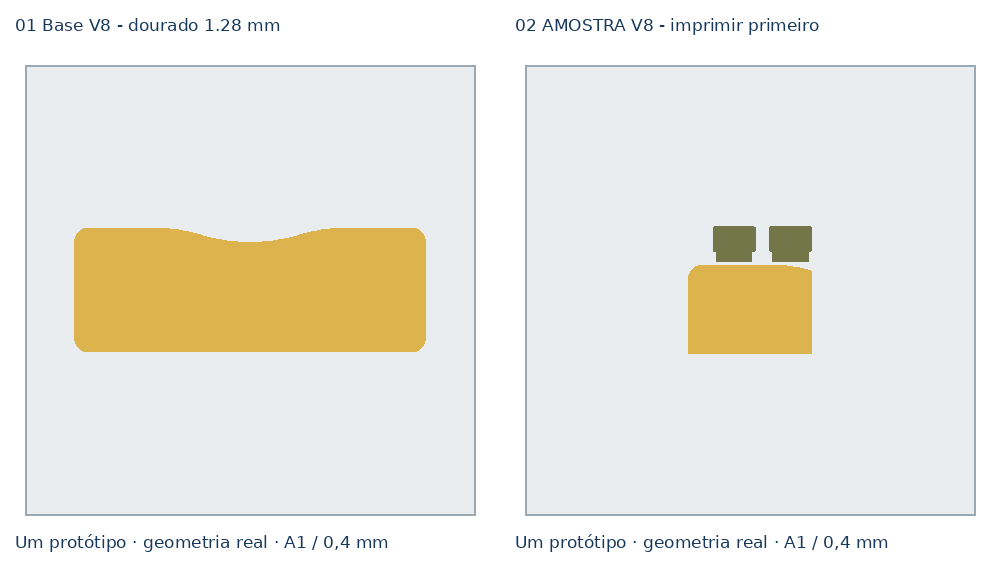

# Clínica Essencial — V8, dourado de 1,28 mm

[Descarregar projeto Bambu A1 / AMS — dois pratos](../../downloads/essencial-compacto-v8-dourado-128-A1-AMS-2-pratos.3mf)

Esta revisão mantém a forma exterior, a altura total de 9,60 mm, os encaixes,
as ranhuras e a orientação invertida da base aprovada.

## Interface de cor

A fronteira verde/dourado desce 0,32 mm:

| Volume | V7 | V8 |
|---|---:|---:|
| Verde | 0–8,64 mm | 0–8,32 mm |
| Dourado | 8,64–9,60 mm (0,96 mm) | 8,32–9,60 mm (**1,28 mm**) |

O verde continua sem uma superfície superior própria. O dourado forma as
oito camadas densas finais e deve absorver melhor pequenas irregularidades da
interface antes do acabamento visível.

## Processo

- Bambu A1, bico 0,4 mm, camada 0,16 mm;
- três paredes e 15% Gyroid;
- sem brim e sem suportes;
- verde e dourado: paredes/interior a 25 mm/s;
- topo dourado: 20 mm/s;
- costuras para trás;
- dourado: fluxo 0,9702 e 215 ºC.

## Imprimir primeiro

Abrir o 3MF como projeto e imprimir **02 AMOSTRA V8 — imprimir primeiro**.
A amostra mantém a interface real e demora cerca de 2 h 28 min. Só imprimir a
base completa se a superfície estiver limpa.

O fatiamento no Bambu Studio 02.09.01.70 terminou sem avisos. A validação é
de geometria e G-code; o acabamento físico ainda depende deste ensaio.

[Relatório de validação](bambu-validation.json).
[Script de construção](../tools/build_essencial_compacto_v8_dourado_128_3mf.py).
