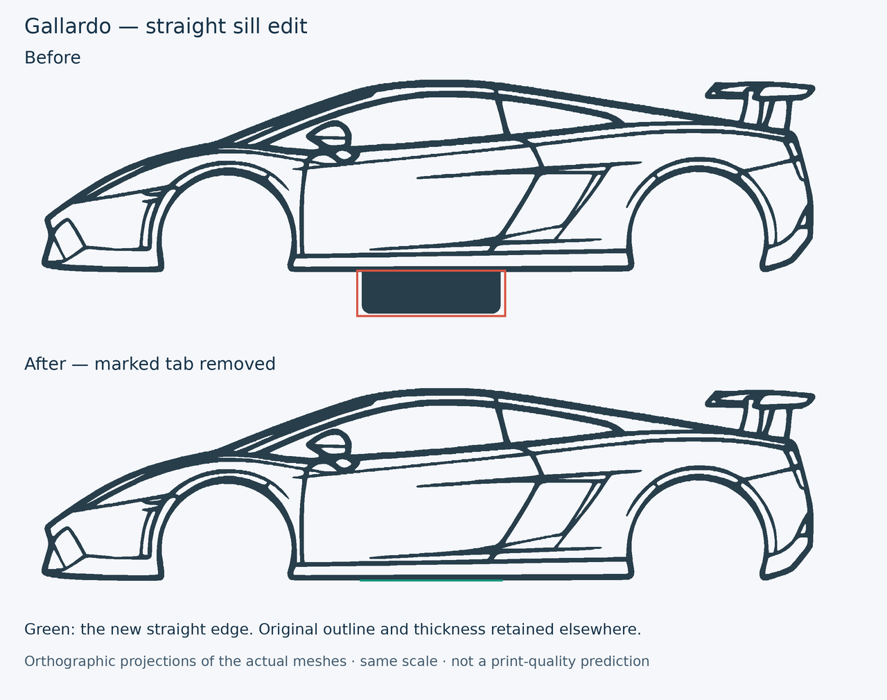

# Gallardo — straight sill edit

[Download edited Bambu project](../../downloads/gallardo-straight-sill-v1.3mf)

[Download STL](../../downloads/gallardo-straight-sill-v1.stl)

[Download project, STL and documentation together](../../downloads/gallardo-straight-sill-v1-pacote.zip)

Removed the rectangular projection under the sill, as marked in red in the
user's reference. The replacement edge is a straight segment joining the
adjacent sill, approximately **51.51 mm** long. The model remains a single
connected, closed solid.

The cut is limited to the under-sill region. Boolean checks confirmed no
added volume and that all removed material lies within that region. Overall
car width remains **279.07 mm** and thickness remains **3.20 mm**. Other
outline details, holes, wheel arches and spoiler are preserved outside the
cut region. The bounding-box height decreases because the tab is gone.

## Project and print settings

Open the 3MF as a project. It keeps the supplied build placement and complete
print configuration **byte for byte**: Bambu A1, **0.2 mm nozzle**, **0.10 mm
layers**, material slot 3, and the source brim policy. This edit does not
apply settings from the separate M7 or QR-base projects. The STL is supplied
in the same flat, diagonal print orientation as the project.

The mesh was checked for watertightness, consistent winding, connectedness,
straight-cut geometry and unchanged width/thickness. The edited project was
also sliced without reported warnings in Bambu Studio **02.08.02.61**, using
its supported `--allow-newer-file` option because the input project was saved
in **02.09.01.70**. This compatibility check does not claim identical G-code
across versions; the delivered project's original settings remain intact.
No physical print was started or tested.

[Validation report](validation.json).
[Reproduction script](../tools/clean_gallardo_straight_sill_v1.py), requiring
the user's original input file and the repository helpers.

Original model attribution from the supplied file: **Dava**,
“Lamborghini Gallardo silhouette”, **Standard Digital File License**.
Original designer and license metadata remain in the edited 3MF. This edit
does not replace the original license or claim authorship of the car design.
