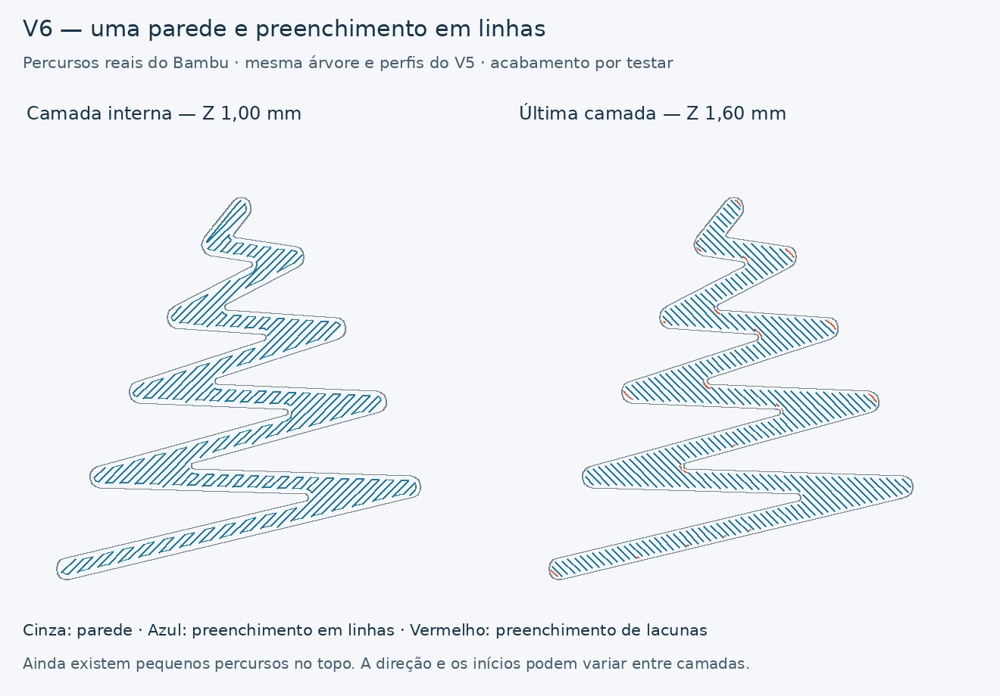

# Árvore M7 — V6, uma parede e linhas

[Descarregar projeto Bambu A1 / AMS](../../downloads/m7-dourado-linhas-v6-A1-AMS-1-prato.3mf)

[Pacote com projeto, STL, imagens e validação](../../downloads/m7-dourado-linhas-v6-pacote.zip)

Este teste aplica a proposta aprovada de uniformizar o preenchimento da
árvore em linhas, depois de o defeito ter reaparecido no azul com o seu
próprio perfil. Reutiliza uma única amostra D do V5: **mesma árvore, mesma
base e um recorte**. Não altera a forma dos alargamentos.

## O que muda

- Uma parede na árvore, como na amostra D anterior.
- Topo e fundo configurados como `monotonicline`; interior sólido como
  `monotonic`, substituindo os preenchimentos anteriores.
- **`detect_narrow_internal_solid_infill = 0`**, ao nível do processo.
  Esta opção é necessária nesta versão: ativa, o fatiador converte o
  preenchimento interno das zonas estreitas em percursos concêntricos,
  mesmo com um padrão de linhas selecionado. Colocá-la apenas nos metadados
  da parte não alterou os percursos neste ensaio. A versão entregue usa a
  configuração de processo efetivamente verificada.
- Na árvore, zero camadas inferiores e cinco camadas superiores / 1 mm de
  espessura superior. O relevo inteiro continua sólido: são cinco camadas
  de 0,20 mm. A base laranja conserva as suas camadas inferiores.
- Mantêm-se os 25 mm/s em todos os percursos de extrusão da árvore e a
  largura nominal de 0,42 mm de parede exterior, topo e interior sólido.
  O Arachne pode adaptar a largura real da parede.

Não se tratam literalmente todas as camadas como primeira camada ou como
superfície superior. As quatro primeiras camadas da árvore são preenchimento
sólido interno; a última é topo. As linhas podem alternar a direção e os
pontos de início. **Ainda existe preenchimento de lacunas no topo**, mostrado
a vermelho na imagem; a entrega não afirma ter removido todos os pequenos
percursos.

## Materiais e utilização

Abrir o 3MF **como projeto**, para conservar as definições por parte e de
processo. Está preparado com os mesmos perfis completos do V5:

| Slot | Material | Fluxo | Bico |
|---|---|---:|---:|
| 1 | Laranja, perfil anterior | 0,931 | 220 °C |
| 2 | Amazon Basics Silk PLA dourado, perfil anterior | 0,9702 | 215 °C |

Os perfis branco/ciano continuam incluídos do projeto de origem, mas não são
usados. A1, nozzle de 0,4 mm, PEI texturado, sem brim nem suportes. Base de
32 × 34 × 0,6 mm e relevo de árvore de 1 mm, sem escala. A torre de purga
continua ativa e há uma mudança de filamento.

Para comparar com o dourado anterior, manter o material e a calibração
dinâmica ativos como nos testes V5. Comparar com a amostra de **um recorte /
uma parede**. Se for usada a opção azul, selecionar também o perfil próprio
do azul, como no controlo anterior, e registar essa escolha.

É uma única amostra, enquanto o V5 tinha quatro. O intervalo entre camadas
na mesma árvore muda com essa disposição. Uma melhoria física será útil,
mas não deve ser atribuída apenas a um parâmetro sem considerar esse contexto.

## Verificação

Bambu Studio **02.08.02.61**, exportação nativa, reabertura e fatiamento sem
avisos. Estimativa do fatiador: **17 min 31 s / 1,86 g**, incluindo purgas e
torre. O tempo final depende das opções de envio e da preparação da máquina.

- Geometria da árvore e da base comparada com a amostra D original por
  volume, dimensões e coordenadas dos vértices após retirar a translação.
- Uma amostra, dois materiais utilizados, cinco camadas na árvore,
  sem extrusão classificada como parede interior.
- Velocidade pedida de 25 mm/s em todos os percursos da árvore, inclusive
  os preenchimentos de lacunas.
- As quatro camadas internas têm a maior parte do comprimento dos segmentos
  longos alinhada a 45°/135°, confirmando linhas reais no G-code.
- Um [controlo de fatiamento](narrow-infill-control.json), alterando apenas
  a deteção de zonas estreitas para ativa, recuperou os circuitos internos.
  Esta comparação demonstra o efeito da opção nos percursos; não demonstra
  a causa física das marcas.

[Relatório da validação](bambu-validation.json).
[Script de construção](../tools/build_m7_gold_lines_v6.py).

O acabamento físico do V6 ainda não foi testado. Não foi iniciada qualquer
impressão pelo agente. O objetivo é verificar se o preenchimento em linhas
reduz as acumulações repetidas nos alargamentos.
