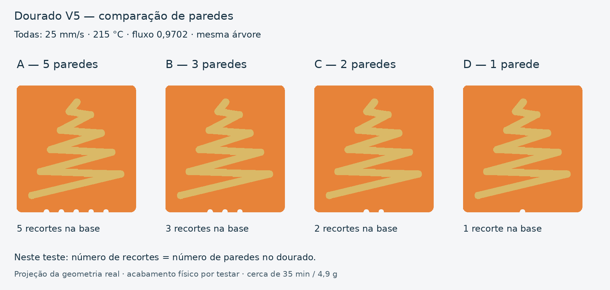
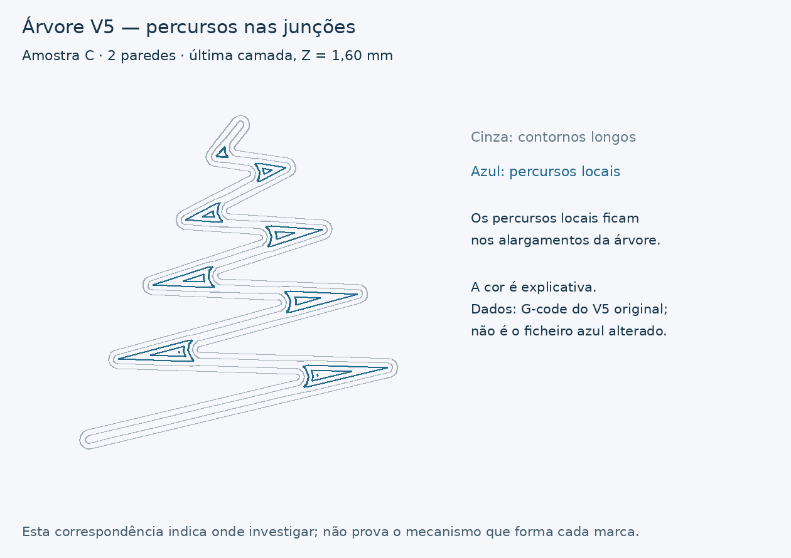

# Dourado — V5, comparação de paredes

[Descarregar projeto Bambu A1 / AMS](../../downloads/m7-dourado-paredes-v5-A1-AMS-1-prato.3mf)

[Pacote com 3MF, STL e documentação](../../downloads/m7-dourado-paredes-v5-pacote.zip)

A sugestão de testar uma parede foi incluída após os ensaios de cinco paredes
e da matriz de velocidades, que mantiveram as acumulações. Este é um ensaio
físico a fazer, não uma solução já demonstrada. Ver a
[pesquisa e as fontes consultadas](../M7DouradoPesquisaV5/README.md).

## Identificação — os recortes correspondem às paredes

| Posição original | Amostra | Recortes na base | Paredes solicitadas no dourado |
|---|---|---:|---:|
| Esquerda | A | **5** | **5** |
| Segunda | B | **3** | **3** |
| Terceira | C | **2** | **2** |
| Direita | D | **1** | **1** |

A correspondência é diferente da calibração de velocidade anterior. **Neste
prato, contar os recortes indica diretamente o número de paredes.** Todas
as bases laranja conservam uma parede; a tabela refere-se ao dourado.

## Condições comuns

- Velocidade uniforme de **25 mm/s** nas paredes e nos preenchimentos dourados.
- Dourado a **215 °C**, fluxo **0,9702**, retração **0,5 mm**, mesmo arrefecimento.
- Topo **concêntrico** em todas. As regiões onde ficam apenas paredes não
  precisam desse preenchimento de topo.
- Cinco, três, duas e uma parede solicitadas: a geometria não muda; o Arachne
  adapta a ocupação e a largura dos percursos.
- Camadas de 0,20 mm; bases de 32 × 34 × 0,6 mm, relevo da árvore de 1 mm,
  árvore original sem escala. Sem brim nem suportes.
- Laranja conserva fluxo 0,931 e 220 °C. A1 / nozzle 0,4 mm / PEI texturado.

Entre as amostras, a única configuração diferente do dourado é o número de
paredes. O topo concêntrico e os limites de preenchimento a 25 mm/s são comuns.
Em relação ao teste V3, esses limites foram acrescentados para os novos
preenchimentos gerados com menos paredes; no controlo de cinco paredes,
essas regiões são ocupadas por paredes.

## Imprimir e comparar

Abrir o 3MF **como projeto** para conservar as substituições por parte.
Imprimir as quatro juntas no único prato. Usar os mesmos rolos e opções de
calibração, com calibração dinâmica ativa. Slots usados: 1 laranja, 2 dourado;
branco/ciano conservados do perfil anterior, mas não são usados.

Fatiado no Bambu Studio **02.08.02.61**, sem avisos: cerca de **34 min 51 s e
4,87 g**, incluindo purgas/torre, com uma mudança de filamento. As estimativas
variam com o fatiador e as opções de envio.

No G-code foram confirmados 25 mm/s em todos os percursos dourados, as paredes
solicitadas em cada parte e a ausência de paredes interiores na amostra de
uma parede. A geometria dos quatro relevos foi comparada com a árvore original.

Comparar os mesmos alargamentos, fios e textura. Se o controlo de cinco
paredes reproduzir as marcas e a de uma melhorar, confirmar depois na placa
completa. Se todas melhorarem, não atribuir o resultado ao número de paredes
sem investigar as restantes diferenças de contexto. Uma parede não significa
que a árvore fique oca: o fatiador preenche a região restante.

Se possível, observar ou filmar um dos alargamentos nas últimas camadas para
ver se o material levanta ao ser depositado ou é arrastado numa passagem
posterior. O projeto não foi enviado à máquina por este fluxo. O resultado físico
comunicado posteriormente pelo utilizador está registado abaixo.

## Resultado físico comunicado

As quatro fotografias posteriores mostram **acumulações nos alargamentos em
5, 3, 2 e 1 parede**, com alguns fios. Uma parede parece aliviar algumas
zonas, mas não elimina o defeito; as fotografias não permitem classificar
quantitativamente os acabamentos. A amostra de cinco recortes também tem
irregularidade localizada na superfície laranja junto à margem esquerda/inferior,
sem causa identificável nesta imagem.

A revisão da última camada confirma que substituir paredes interiores por
topo concêntrico mantém percursos locais nas junções. Agrupando extrusões
consecutivas pela continuidade e pelo tipo de percurso, há 17, 17, 19 e 29
percursos em A/B/C/D, respetivamente. Estes números não são contagens de
retrações nem provam a origem de cada marca. **Uma parede não simplificou
esta camada para um único percurso contínuo.**

Ver [registo e limites da análise](physical-feedback.json). O relatório
`bambu-validation.json` descreve a validação anterior à impressão; o campo
`physical_print_tested: false` refere-se àquela fase. O resultado recebido
mais tarde está no registo de feedback e não constitui um ensaio realizado
pelo agente.

## Controlo com azul e perfil próprio

O utilizador imprimiu a árvore em azul e confirmou que selecionou o perfil
do azul. A fotografia mostra marcas semelhantes nas mesmas zonas alargadas.
Os dois recortes visíveis correspondem à amostra C, de duas paredes. O 3MF
alterado pelo utilizador não foi recebido nem inspecionado nesta atualização.

Este resultado enfraquece a hipótese de um defeito exclusivo do dourado Silk.
A geometria, as opções comuns de processo, os movimentos e a impressora
continuam candidatos; não é uma prova de erro exclusivo da malha ou do
fatiador. A malha original C é fechada, com orientação consistente, um só
componente ligado e sem faces duplicadas. As únicas alturas dos vértices são
0,6 e 1,6 mm: o relevo original é uma extrusão plana de 1 mm.

A imagem usa o G-code original do V5, não um G-code do azul. Mostra a posição
dos pequenos percursos nos alargamentos. A correspondência visual com as
marcas indica onde investigar, sem estabelecer como cada marca se forma.
Antes de voltar a ajustar o material dourado isoladamente, a prioridade passa
aos percursos e ao momento em que a acumulação começa. Não foi criado outro
projeto de impressão nesta atualização.
