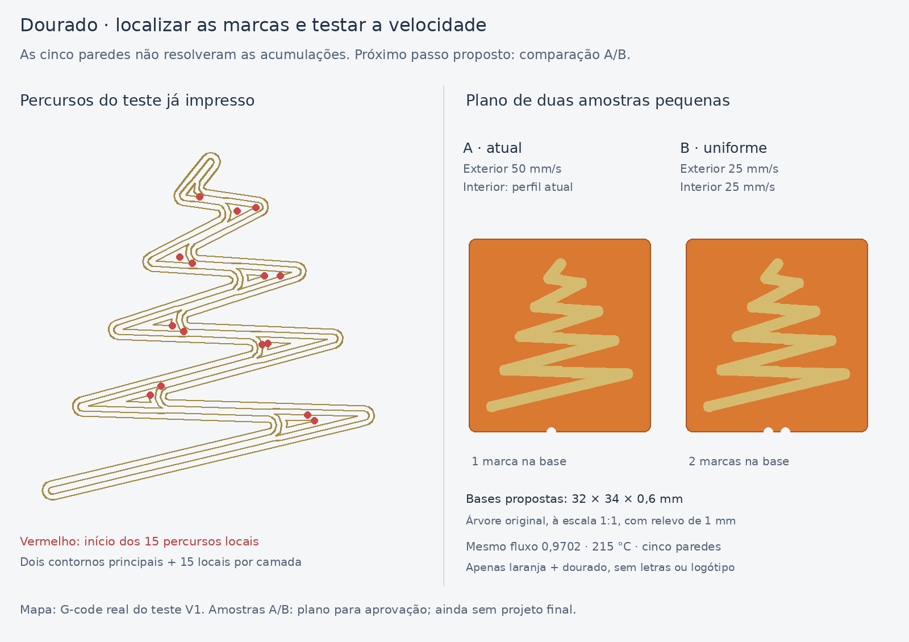

# Dourado M7 — revisão após o teste de cinco paredes

O utilizador imprimiu o teste V1, derivado da V8, com dourado a **0,9702**.
A fotografia recebida em 06/11/2026 mostra acumulações salientes nas zonas
largas da árvore e alguns fios. Os trechos compridos parecem mais regulares;
a comparação fotográfica não permite medir a melhoria ou agravamento.

**Conclusão do ensaio:** retirar os pequenos preenchimentos de topo e lacunas
não foi suficiente. Não aumentar novamente as paredes como solução presumida.

## O que permanece nos percursos

A última camada da árvore conserva dois percursos principais e **15 percursos
locais**, incluindo contornos interiores pequenos e dois traços muito curtos.
A maior parte dos percursos locais começa/termina nos alargamentos dos ramos.
As suas extensões totais vão de cerca de 0,06 a 14,93 mm. As larguras pedidas
pelo Arachne no dourado variam aproximadamente entre 0,42 e 0,63 mm.

O mapa representa os arranques desses percursos na camada Z=1,60 mm. As
posições são uma pista para transições de pressão, arranques/fins, deposição
nas curvas e arrastamento pelo bico. Não prova que as costuras, a temperatura
ou a humidade sejam a causa. Os fios justificam observar o comportamento nas
deslocações, mas não demonstram por si só filamento húmido.

O perfil contém retração específica do dourado de 0,5 mm, temperatura de
215 °C e rácio de fluxo 0,9702. O G-code inclui a chamada de calibração dinâmica
do firmware na mudança para o dourado. O valor efetivamente aplicado na
máquina não é demonstrado pela foto ou pelo sinalizador genérico
`enable_pressure_advance` do perfil; não se pode concluir que a compensação
esteja desligada apenas por esse campo.

O utilizador indicou a marca como **Amazon**. A designação exata do produto e
a classificação PLA / PLA Silk continuam por confirmar. Não inferir Silk
apenas pelo brilho, nem alterar a temperatura com base apenas nessa marca.

## Próximo ensaio proposto — plano, ainda sem 3MF final

Duas árvores à escala original, cada uma numa base laranja de **32 × 34 ×
0,6 mm**, com o mesmo relevo dourado de **1 mm**:

- **A:** cinco paredes e velocidades do teste já impresso. Uma marca na base.
- **B:** igual à A, com paredes interiores/exteriores do dourado a **25 mm/s**.
  Duas marcas na base.

Conservar fluxo 0,9702, 215 °C, retração, arrefecimento, altura de camada e
os restantes parâmetros. As marcações são pequenos recortes na base laranja,
sem acrescentar outra cor. Não foram calculadas estimativas de tempo ou
material deste plano, pois o projeto de impressão ainda não foi preparado.

O teste visa avaliar a uniformização da velocidade nas mudanças de largura e
nos pequenos contornos. É uma hipótese a experimentar, não uma correção física
já validada. Usar A como referência é essencial: **se A sair limpa**, o ensaio
não reproduziu o defeito e não demonstra que B o resolveu. Nesse caso, voltar
às diferenças da placa completa: pausas e percursos das outras cores, sequência
AMS, arrefecimento e eventuais contactos do bico.

Este plano é apresentado antes de preparar os ficheiros da nova amostra,
seguindo a preferência do utilizador de aprovar primeiro a imagem/plano de
novas peças. Os próximos STL/3MF dependem dessa aprovação. O teste V1 e a V8
permanecem disponíveis e os respetivos relatórios de fatiamento são históricos.
