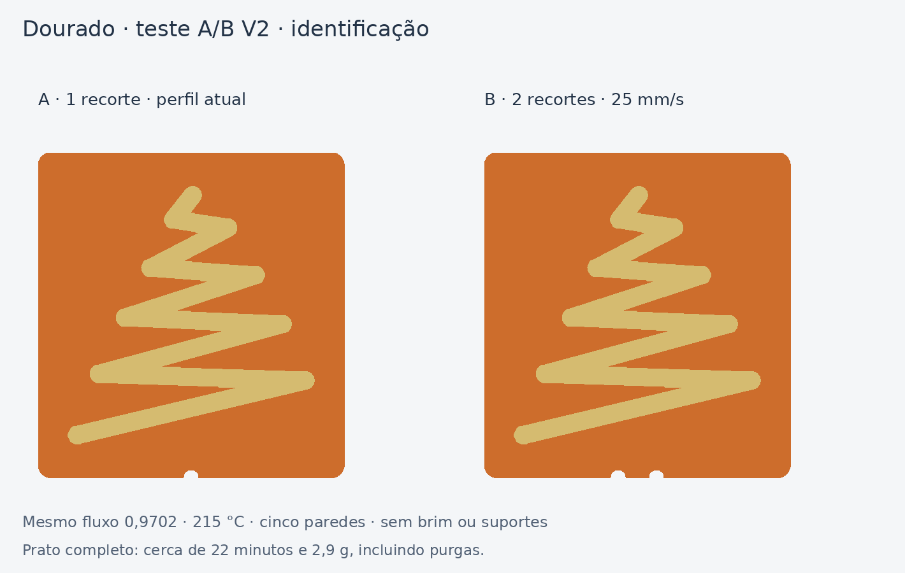

# Dourado M7 — teste A/B V2

Plano aprovado pelo utilizador: «ok, gera que eu testo».

[Descarregar o projeto Bambu A1 / AMS](../../downloads/m7-dourado-teste-ab-v2-A1-AMS-1-prato.3mf)

[Pacote com 3MF, STL e documentação](../../downloads/m7-dourado-teste-ab-v2-pacote.zip)



## Imprimir

Abrir o 3MF **como projeto**, mantendo as substituições por parte/objeto.
Há um único prato com duas amostras, impressas juntas por camada:

| Amostra | Identificação física | Paredes exteriores douradas | Paredes interiores douradas |
|---|---|---:|---:|
| A, esquerda | **1 recorte** na base | 50 mm/s | 100 mm/s configurados, limitados pelo fluxo volumétrico |
| B, direita | **2 recortes** na base | **25 mm/s** | **25 mm/s** |

No G-code deste prato, A pede 50 mm/s no exterior e cerca de 42–63 mm/s nos
interiores; B pede 25 mm/s em ambos, incluindo os pequenos contornos.
A aceleração pode impedir atingir a velocidade pedida em segmentos curtos.

Configuração: **Bambu Lab A1, nozzle 0,4 mm, PEI texturado**. Usar os mesmos
rolos e opções de calibração do teste anterior; manter a calibração dinâmica
de fluxo ativa. Slots usados: **1 laranja, 2 dourado**. Os perfis branco/ciano
foram conservados do projeto de referência, mas não são usados nesta impressão.

## O que fica igual

- Árvore original, sem escala nem alteração de espessura: cerca de 25,80 ×
  27 mm, relevo de 1 mm, sobre base laranja de 32 × 34 × 0,6 mm.
- Cinco paredes solicitadas no dourado, uma na base laranja, Arachne.
- Fluxo laranja 0,931; dourado **0,9702**.
- Temperatura laranja 220 °C; dourado **215 °C**.
- Retração específica do dourado **0,5 mm**, arrefecimento e restantes perfis
  conservados do teste V1.
- Camadas de 0,20 mm; sem brim nem suportes.

A única diferença de configuração entre os relevos A e B é a velocidade das
paredes interiores/exteriores. As bases diferem nos recortes de identificação.
A temperatura não foi alterada com base na indicação de marca Amazon; a
designação exata PLA / PLA Silk continua por confirmar.

## Estimativa e verificação

Fatiado no Bambu Studio **02.08.02.61**, sem avisos: cerca de **22 min 07 s e
2,86 g**, incluindo purgas e torre, com **uma mudança de filamento**.
As estimativas variam com a versão do fatiador e as opções de envio.

Confirmados no G-code: bases laranja a Z=0,20/0,40/0,60 mm; ambas as árvores
douradas a Z=0,80–1,60 mm; ausência de branco/ciano, brim e suportes; velocidades
da B limitadas a 25 mm/s. A geometria do relevo nativo foi comparada com a
árvore extraída do projeto anterior. O 3MF contém a configuração completa
conservada desse projeto, sem combinar perfis de outras impressoras.

## Como interpretar

Observar os mesmos alargamentos dos ramos, as acumulações e os fios. Se
possível, observar uma das últimas camadas de dourado para perceber se a marca
surge ao entrar/sair do contorno ou depois, numa deslocação.

- **A má e B melhor:** a velocidade mais uniforme é uma pista útil; confirmar
  depois na placa completa, sem mudar simultaneamente o fluxo ou temperatura.
- **Ambas más:** a velocidade, por si só, não resolveu; usar o resultado para
  investigar pressão/arranques, retração, contacto do bico ou material.
- **Ambas boas:** o defeito da placa completa não foi reproduzido. Não concluir
  que os 25 mm/s o resolveram. A amostra não contém estrela, branco/ciano nem
  as respetivas pausas e percursos da sequência AMS completa.

A comparação isola a velocidade entre as duas árvores nas condições deste
prato; não reproduz toda a história térmica da placa completa. O resultado
físico ainda não foi testado. Nenhum trabalho foi enviado à impressora.

## Reproduzir

```bash
python fusion/tools/build_m7_gold_ab_v2.py --bambu-bin /caminho/bin/bambu-studio --work-dir /pasta/de/trabalho
```

O script extrai a árvore do 3MF anterior, gera as bases, conserva a configuração
completa e usa o Bambu nativo para exportar e fatiar. Dependências: numpy,
trimesh, manifold3d, Pillow e auxiliares do repositório. O caminho Linux de
bibliotecas deve ser adaptado noutro ambiente. Não executa Fusion nem inicia
impressões físicas.
