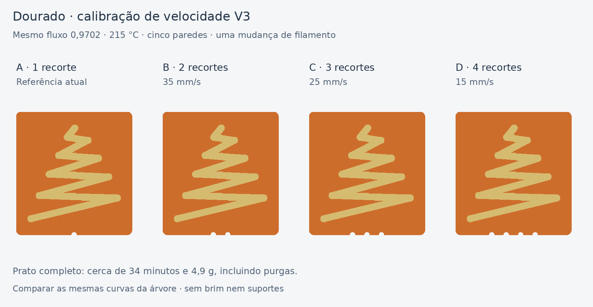

# Dourado M7 — calibração de velocidade V3

**Ensaio físico recebido em 06/11/2026:** as quatro amostras mantêm
acumulações nos alargamentos. Reduzir a velocidade até 15 mm/s não resolveu
o acabamento. Não foi escolhida uma vencedora; ver `physical-feedback.json`.

Prato de quatro amostras aprovado pelo utilizador, para comparar as acumulações
nos alargamentos da árvore mantendo fluxo, temperatura e retração.

- [Projeto Bambu A1 / AMS — um prato](../../downloads/m7-dourado-calibracao-velocidade-v3-A1-AMS-1-prato.3mf)
- [Pacote com projeto, STL e documentação](../../downloads/m7-dourado-calibracao-velocidade-v3-pacote.zip)



## Imprimir e identificar

Abrir o 3MF **como projeto**, mantendo as configurações por parte/objeto.
Imprimir as quatro amostras juntas no único prato. Usar os mesmos rolos e
opções do teste anterior, com calibração dinâmica de fluxo ativa.

| Amostra | Recortes na base | Parede exterior dourada | Parede interior dourada |
|---|---:|---:|---:|
| A — referência | **1** | 50 mm/s | Perfil atual: 100 mm/s configurados, limitados pelo fluxo |
| B | **2** | **35 mm/s** | **35 mm/s** |
| C | **3** | **25 mm/s** | **25 mm/s** |
| D | **4** | **15 mm/s** | **15 mm/s** |

No prato original, visto de cima, a ordem da esquerda para a direita é A, B,
C, D. Os recortes continuam a identificar cada amostra depois de a retirar
do prato. O G-code pede cerca de 42–63 mm/s no interior da A; nas B/C/D,
foram confirmados os valores constantes da tabela. Segmentos curtos podem
não atingir a velocidade pedida devido à aceleração.

## Condições comuns

- A1, nozzle de 0,4 mm, PEI texturado, camadas de 0,20 mm.
- Bases laranja de 32 × 34 × 0,6 mm, com uma parede solicitada.
- Árvore original, sem escala ou alteração de espessura: cerca de 25,80 ×
  27 mm, relevo de 1 mm, cinco paredes solicitadas no dourado.
- Fluxo laranja 0,931 e dourado **0,9702**.
- Temperatura laranja 220 °C e dourado **215 °C**.
- Retração específica do dourado **0,5 mm**, arrefecimento e restantes
  configurações conservados do teste anterior.
- Sem brim nem suportes; torre de purga ativa.

A única diferença de configuração entre as árvores é a velocidade das
paredes interiores/exteriores. As bases diferem nos recortes de identificação.
O Arachne adapta as larguras dentro da mesma geometria.

Slots usados: **1 laranja, 2 dourado**. Os perfis branco/ciano permanecem no
projeto de referência, mas não são usados nesta impressão. Não substituir
os perfis calibrados do projeto ao importar apenas a geometria.

## Estimativa e verificação

Fatiado no Bambu Studio **02.08.02.61**, sem avisos: cerca de **34 min 25 s e
4,87 g**, incluindo purgas/torre, com **uma mudança de filamento**. A estimativa
pode variar com a versão do fatiador e as opções de envio.

Verificados: quatro relevos com volume/dimensões iguais à árvore original;
primeiras três camadas das bases apenas laranja; cinco camadas dos relevos
apenas dourado; velocidades por amostra no G-code; ausência de branco/ciano,
brim e suportes; limites do prato. Os parâmetros materiais e os restantes
parâmetros de impressão foram comparados com os do projeto anterior.

## Avaliar

Comparar as acumulações nas mesmas curvas, os fios, a regularidade dos traços
e o brilho. Fotografar as quatro juntas, deixando visíveis os recortes.
Escolher a amostra mais rápida que tenha acabamento aceitável; a velocidade
mais baixa não é, por si só, garantia de melhor resultado.

Se A reproduzir o defeito e alguma das restantes melhorar, confirmar depois
a velocidade escolhida na placa completa. Se todas saírem bem, o ensaio não
reproduziu o problema da placa: não permite atribuir a melhoria à velocidade.
Se todas saírem mal, investigar outro parâmetro com a velocidade fixa.

As quatro amostras não contêm estrela, branco/ciano nem as pausas/deslocações
da impressão multicolor completa. O ensaio compara velocidades nas condições
deste prato. As fotografias do ensaio físico mostram a persistência do defeito. A preparação
do projeto não enviou nenhuma impressão à máquina.

## Reproduzir

```bash
python fusion/tools/build_m7_gold_speed_v3.py --bambu-bin /caminho/bin/bambu-studio --work-dir /pasta/de/trabalho
```

O script conserva a configuração completa da referência, extrai a árvore,
gera as bases e verifica o projeto e o G-code nativos. Dependências: numpy,
trimesh, manifold3d, Pillow e auxiliares do repositório. Adaptar o caminho de
bibliotecas Linux a outro ambiente. Não executa Fusion nem inicia impressões.
