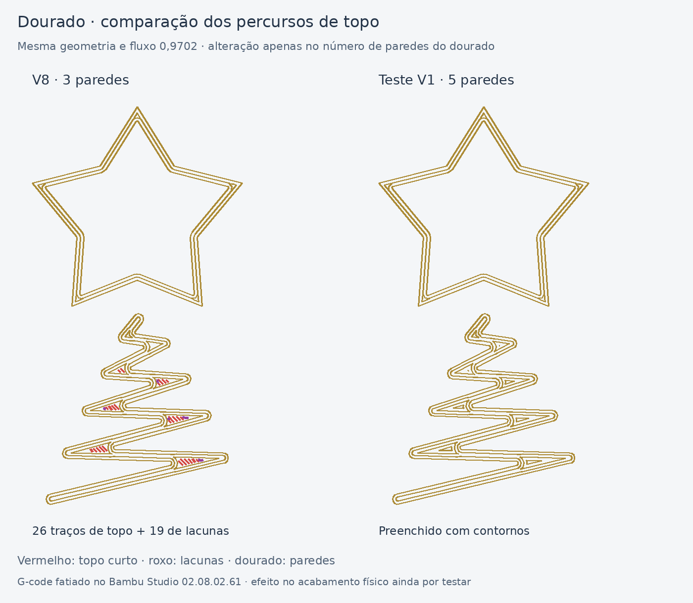

# M7 — teste do dourado V1: cinco paredes

**Resultado físico recebido em 06/11/2026:** o teste foi impresso e as
acumulações na árvore continuam. A remoção dos pequenos preenchimentos
não foi suficiente para resolver o acabamento. Ver a
[revisão e o próximo plano de teste](../M7DouradoRevisaoV2/README.md).

O utilizador confirmou que a placa fotografada foi impressa com a V8 e rácio
de fluxo dourado **0,9702**. Assinalou na prévia os pequenos traços de
preenchimento nos alargamentos da árvore e nos cantos inferiores da estrela.
A fotografia mostra acumulações nessas zonas e alguns fios. A coincidência
é uma hipótese de trabalho; a foto não demonstra uma causa única.

[Projeto de teste A1 / AMS](../../downloads/m7-tijolo-teste-dourado-v1-5-paredes-A1-AMS-2-pratos.3mf)

**Imprimir apenas o prato 2.** O corpo do prato 1 foi conservado da V8 e não
precisa de ser repetido. Abrir o ficheiro como projeto, voltar a fatiar e
manter as mesmas opções de envio e filamentos usados na placa V8.

## Uma alteração de impressão

A definição de paredes na **parte dourada** passa de **3 para 5**.
O Arachne adapta as paredes ao espaço disponível dentro do mesmo desenho.
O fundo laranja continua com uma parede; branco/ciano continuam com três.
Todas as coordenadas de malha e dimensões são iguais à V8.

Foram conservados o fluxo dourado 0,9702, temperatura 215 °C, velocidades,
arrefecimento, retração, calibrações, sequência de cores e os outros materiais.
Isto permite testar a alteração dos percursos antes de mexer simultaneamente
noutros parâmetros. A placa não é uma nova versão de geometria.

## Comparação no fatiador

| Opção avaliada | Resultado no topo do dourado |
|---|---|
| V8, três paredes | 26 segmentos de superfície superior e 19 de preenchimento de lacunas |
| Três paredes, topo concêntrico | Altera a direção do preenchimento; ainda ficam pequenos percursos interiores |
| Cinco paredes | Só paredes exteriores/interiores; sem os pequenos preenchimentos de topo ou lacunas |
| Cinco paredes e topo concêntrico | Mesmo resultado que cinco paredes neste modelo |
| Sete paredes | Mesmo resultado que cinco paredes; não acrescenta benefício neste modelo |

No teste escolhido, **todas as cinco camadas de dourado, Z=0,80–1,60 mm,
ficam preenchidas por contornos**. O fatiamento conserva as extrusões dos
outros materiais, incluindo o fundo laranja, e as 11 trocas de filamento.
Os contornos interiores continuam a ter costuras e mudanças de direção;
a remoção destes preenchimentos não garante eliminar todas as marcas ou fios.

Bambu Studio **02.08.02.61**, referência e candidato fatiados na mesma versão:

| | V8 de referência | Teste V1 |
|---|---:|---:|
| Tempo do prato 2 | 51 min 50 s | 51 min 46 s |
| Material total com purgas/torre | 8,5560 g | 8,5562 g |
| Dourado na própria peça | 0,4042 g | 0,4044 g |
| Avisos do fatiamento | Nenhum | Nenhum |

O consumo é praticamente igual. As estimativas podem variar ao voltar a
fatiar noutra versão ou alterar perfis/opções de envio.

## Avaliar o exemplar

Comparar os mesmos pontos da árvore e da estrela com a placa V8, além dos
fios entre ramos. Se as acumulações melhorarem mas os fios persistirem,
tratar separadamente o escorrimento nas deslocações, a retração e o estado
do filamento, mantendo o fluxo como referência até haver evidência para o
alterar. O exemplar fotografado pelo utilizador confirmou a persistência
das acumulações; o teste não foi aprovado como solução de acabamento.

O script `fusion/tools/build_m7_gold_test_v1.py` verifica que a única definição
de impressão alterada é o número de paredes do dourado, compara as extrusões
dos restantes materiais e gera a imagem a partir do G-code. Os resultados e
hashes estão em `bambu-validation.json`.
