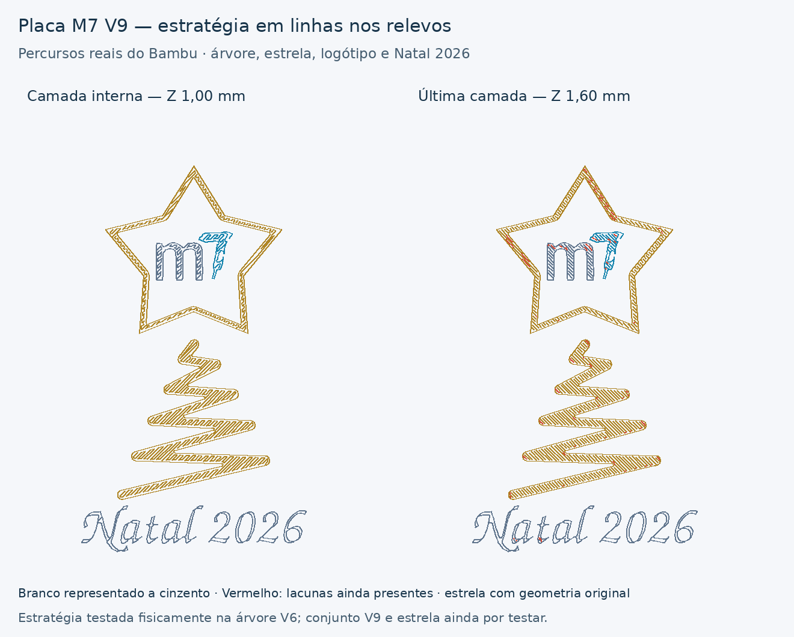

# M7 — placa V9, relevos com a estratégia em linhas

[Descarregar projeto Bambu A1 / AMS, dois pratos](../../downloads/m7-tijolo-v9-relevos-em-linhas-A1-AMS-2-pratos.3mf)

[Pacote com projeto, documentação e imagens](../../downloads/m7-tijolo-v9-relevos-em-linhas-pacote.zip)

Aplica à placa completa a estratégia do
[teste V6 da árvore](../M7DouradoLinhasV6/README.md), cujo resultado físico foi
comunicado pelo utilizador como satisfatório. A árvore impressa perdeu as
acumulações salientes mais evidentes nas junções. A mesma melhoria física
ainda não foi confirmada na estrela nem nos restantes relevos do V9.

## O que imprimir

1. Prato 1: corpo do tijolo, com a geometria anterior.
2. **Prato 2: placa completa**, com fundo laranja, estrela e árvore douradas,
   logótipo branco/ciano e inscrição branca “Natal 2026”.

**Se já tens o corpo, imprime apenas o prato 2.** Abrir o 3MF como projeto
para conservar as configurações por parte e por objeto. Manter a calibração
dinâmica ativa no envio, como nos testes anteriores.

## Estratégia aplicada aos relevos

Árvore e estrela partilham a parte dourada; o logótipo/inscrição branca e o
“7” ciano receberam também a mesma estratégia:

- Uma parede solicitada, topo/fundo `monotonicline` e interior sólido
  `monotonic`.
- `detect_narrow_internal_solid_infill = 0` ao nível do processo da placa,
  para evitar a conversão automática dos interiores estreitos em percursos
  concêntricos.
- Nos relevos de 1 mm: cinco camadas superiores / 1 mm e zero camadas
  inferiores; o relevo permanece sólido, com quatro camadas internas e uma
  camada final de topo a 0,20 mm.
- Velocidades de parede e preenchimentos a 25 mm/s. Os patamares de
  velocidade de saliência de 25/50/75% também foram limitados a 25 mm/s
  nas partes dos relevos, pois o “7” gerava alguns segmentos mais rápidos.
  O G-code final confirma 25 mm/s nos três materiais dos relevos.
- Mantém-se o Arachne. As larguras nominais de parede exterior, topo e
  interior sólido são 0,42 mm; o gerador pode adaptar a largura da parede.

Ainda existem pequenos preenchimentos de lacunas, assinalados a vermelho
na imagem. As linhas podem mudar de direção e de início entre camadas.
Não se afirma ter transformado todas as camadas literalmente em primeira
camada ou superfície de topo.

## Estrela e geometria

**Não foi necessário engrossar a estrela para obter o preenchimento em
linhas no fatiador.** Mantém 30 mm de largura exterior e 1 mm de relevo.
O primeiro ensaio conserva a forma para avaliar esta estratégia antes de
introduzir uma alteração de espessura.

Todos os ficheiros `3D/` do projeto V8 foram preservados byte a byte,
incluindo a pintura da costura. Os vértices e triângulos transformados
também foram comparados: mantêm-se o corpo, a placa e todas as decorações.
Fundo de 46,4 × 66,4 × 0,6 mm, placa decorada com 1,6 mm de altura total;
folga CAD do encaixe de 0,30 mm por lado e espaço nominal de cola de 0,10 mm.
O encaixe físico do V9 não foi ensaiado pelo agente.

O corpo conserva as opções anteriores através de substituições ao nível
do seu objeto. No mesmo fatiador, o conjunto dos segmentos de extrusão do
corpo é idêntico ao V8, incluindo coordenadas, velocidades e extrusão.
A ordem de alguns segmentos varia, pelo que não se afirma igualdade do
G-code completo ou de todos os movimentos de deslocação.

## Materiais conservados

| Slot | Material | Fluxo | Bico |
|---|---|---:|---:|
| 1 | Laranja | 0,931 | 220 °C |
| 2 | Amazon Basics Silk PLA dourado | 0,9702 | 215 °C |
| 3 | Branco | 0,98 | 220 °C |
| 4 | Ciano | 0,98 | 220 °C |

Os parâmetros de material, retração, arrefecimento e limites volumétricos
foram comparados com o V6 bem sucedido e conservados. A1, nozzle de 0,4 mm,
PEI texturado, camadas de 0,20 mm. **Sem brim nem suportes**; torre de
preparação ativa no prato multicolor.

## Validação e estimativas

Bambu Studio **02.08.02.61**, dois pratos fatiados sem avisos:

| Prato | Conteúdo | Tempo estimado | Material, incluindo purgas/torre | Mudanças |
|---|---|---:|---:|---:|
| 1 | Corpo | 3 h 11 min | 43,82 g | 0 |
| 2 | Placa decorada | **54 min 05 s** | **8,56 g** | **11** |

Os tempos podem variar com o fatiador e a preparação/envio. A análise do
G-code confirmou que o laranja termina a Z=0,60 mm, seguido de dourado,
branco e ciano a Z=0,80–1,60 mm, sem paredes interiores nos relevos.
Foram revistos separadamente os preenchimentos internos da árvore e da
estrela, além da imagem dos percursos do conjunto.

[Relatório completo](bambu-validation.json).
[Script de construção e validação](../tools/build_m7_brick_lines_v9.py).

A estratégia tem feedback físico favorável na árvore V6. A placa completa
V9, a estrela e as restantes decorações ainda precisam de ensaio físico.
Não foi iniciada qualquer impressão pelo agente.
