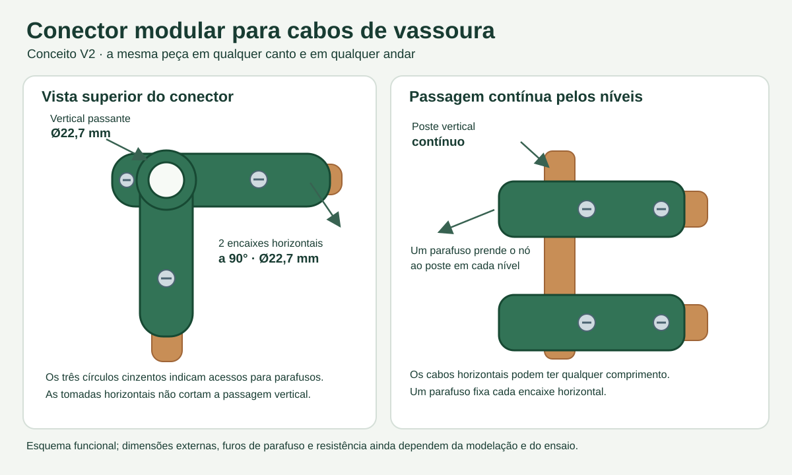

# Móvel para filamento — conceito V2, cabos contínuos

**Estado:** protótipo 3D criado em 15/11/2026 a pedido do utilizador. A V1 continua arquivada. Ainda não há teste de carga nem de encaixe físico.

## Decisões do utilizador

- Seis rolos por andar, em pé e apoiados em dois varões.
- Um conector em cada canto com **dois encaixes horizontais a 90° e uma passagem vertical**. O cabo vertical de 1 m atravessa todos os conectores dos níveis intermédios sem cortes.
- Os **furos para os cabos têm Ø22,7 mm**. Este valor é do furo, não do diâmetro medido do cabo. O diâmetro real ainda tem de ser verificado em vários pontos do cabo, porque madeira e revestimentos podem variar.
- Um pequeno parafuso para madeira em cada cabo, por conector: dois nas tomadas horizontais e um na passagem vertical. O parafuso vertical prende o nível à altura escolhida. Os horizontais retêm os varões nas tomadas.
- O conector aceita cabos contínuos: permite usar os de 1 m inteiros e também cabos cortados pelo utilizador, sem alterar a peça impressa. O comprimento escolhido para cada lado não faz parte deste projeto 3D.

## Geometria do conector proposta

- Canal vertical cilíndrico **passante Ø22,7 mm**, sem batente, para deslizar pelo cabo de 1 m.
- Duas tomadas horizontais **cegas Ø22,7 mm** a 90°, com 39 mm de profundidade nominal cada. Não atravessam o canal vertical; a geometria mantém material entre as cavidades. O topo interno em lágrima permite imprimir na posição vertical sem suportes e deixa livre a secção circular completa para o cabo.
- Três acessos externos para parafusos, desencontrados para não se cruzarem: um radial para o poste vertical e um por baixo de cada varão horizontal. Furo Ø3,6 mm no plástico, com rebaixo Ø7,2 mm para cabeça cilíndrica; pré furo mais pequeno na madeira feito depois de posicionar o nível. Proposta inicial: parafusos de madeira Ø3–3,5 mm e cerca de 25 mm de comprimento; confirmar o engate real e que a ponta não atravessa o cabo.
- Pé impresso separado que recebe a ponta inferior do poste; tampa superior opcional. O mesmo conector serve nos quatro cantos, rodado conforme a posição.

## Uso modular

O mesmo conector serve em qualquer canto e em qualquer andar. Os postes verticais passam através dos nós de vários níveis; cada nó é deslizado até à altura desejada e preso com o seu parafuso. Os dois cabos horizontais entram nas respetivas tomadas e são presos com um parafuso cada. Os cabos podem ter o comprimento que o utilizador decidir, inclusive 1 m inteiro; **não há comprimento de corte embutido na geometria nem lista de cortes**.

## Verificações antes do projeto final

1. Medir o diâmetro real de cada cabo em vários pontos e imprimir `fit_coupon.stl` antes do conector. A folga nominal não garante encaixe se a madeira não for cilíndrica.
2. Verificar material e rigidez dos cabos ao montar o móvel. Dois varões de madeira de 1 m com seis rolos carregados podem fletir; a estrutura longa pode precisar de apoio intermédio, diagonais ou fixação à parede.
3. Confirmar diâmetro e comprimento dos parafusos depois de conhecer a parede real do conector e testar aperto em madeira. Os parafusos nos postes suportam a altura dos níveis; a retenção estrutural requer ensaio com carga real.

## Ficheiros do protótipo

- `conector.scad`: fonte paramétrica. `part` escolhe `connector`, `foot` ou `fit_coupon`.
- `connector.stl`: nó universal, uma peça, 101 × 101 × 56 mm.
- `foot.stl`: pé circular Ø76 × 22 mm, um parafuso lateral.
- `fit_coupon.stl`: anilha de prova do furo Ø22,7 mm.
- `render_preview.py`: pré-visualização do STL em Blender com cabos exemplificativos.

Os três STL são malhas fechadas. Não existe 3MF com perfil de impressora, pois o utilizador não indicou nesta retoma qual das suas impressoras usará. O conector foi desenhado para impressão de pé, sem suportes; o comportamento estrutural e a facilidade de aparafusar dependem do ensaio físico.
