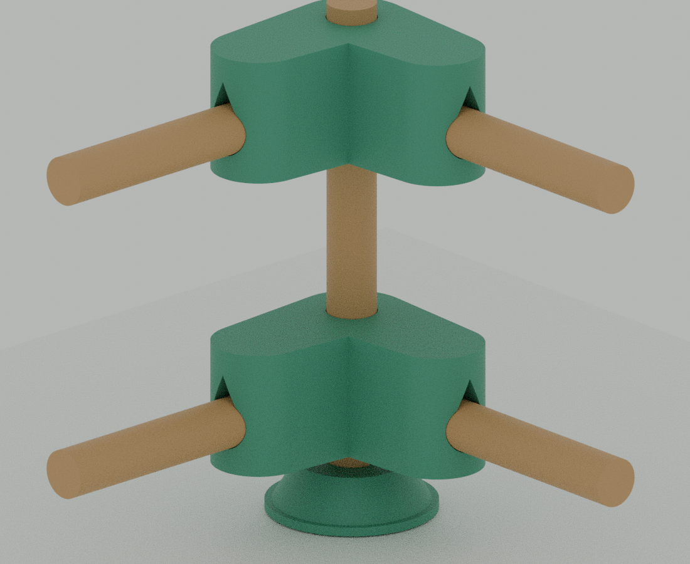

# Conector modular para o móvel de filamentos — protótipo V2

Este projeto contém **um único tipo de nó de canto** para os andares do móvel. Dois cabos horizontais entram a 90°; um poste vertical passa através da peça de baixo a cima. O utilizador decide o comprimento dos cabos e pode deixar os postes de 1 m contínuos. Cada cabo fica retido por um pequeno parafuso para madeira. Os rolos previstos ficam em pé sobre dois varões por andar.

## Ficheiros

- `conector.scad`: fonte paramétrica OpenSCAD; alterar `bore_d` se um teste físico exigir outra folga.
- `connector.stl`: nó universal Ø22,7 mm nas três passagens, 101 × 101 × 56 mm.
- `foot.stl`: pé Ø76 × 22 mm para a ponta inferior do poste, com parafuso lateral.
- `fit_coupon.stl`: pequena anilha de teste do furo Ø22,7 mm.
- `render_preview.py`: gera as vistas a partir dos STL exportados. Os cabos na imagem são exemplos, não estão incluídos nos ficheiros de impressão.
- `../../designs/movel-filamentos-modular-v2-conceito.svg`: esquema editável dos três acessos.
- `../../designs/movel-filamentos-modular-v2-furos-cad.png`: vista inferior do nó para localizar os furos.

## Medidas funcionais

| Elemento | Medida nominal |
| --- | ---: |
| Furos para cabos, incluindo passagem vertical | Ø22,7 mm |
| Profundidade de cada tomada horizontal | 39 mm |
| Furo de passagem para parafuso no plástico | Ø3,6 mm |
| Rebaixo para a cabeça cilíndrica | Ø7,2 × 2,8 mm |
| Área ocupada por cada nó | 101 × 101 × 56 mm |

A abertura interna de cada tomada horizontal conserva o círculo Ø22,7 mm e acrescenta um teto pontiagudo: isso permite imprimir o túnel sem suportes. As tomadas são cegas e deixam material entre os cabos horizontais e o poste vertical. O furo vertical atravessa o nó inteiramente, sem batente.

## Impressão e montagem de prova

1. Imprimir `fit_coupon.stl` e experimentá-lo em **vários pontos** do cabo real. A madeira pode variar de diâmetro e não ser perfeitamente redonda. Se o cabo não passar livremente, ajustar `bore_d` no OpenSCAD e voltar a exportar os três STL.
2. Imprimir o nó na posição original do STL: face larga plana no prato, passagem vertical ao longo de Z. Não ativar suportes nem brim por defeito. Para PETG e bico 0,4 mm, um ponto de partida é camada 0,20 mm, cinco paredes e 35% gyroid; afinar com o perfil do filamento real.
3. Deslizar o nó pelo poste até à altura escolhida. Encaixar os cabos horizontais até ao fundo das respetivas tomadas. Marcar pela abertura dos furos, retirar os cabos e fazer pré furos na madeira antes de colocar os parafusos.
4. Começar com parafusos para madeira de cabeça cilíndrica Ø3–3,5 × cerca de 25 mm; conferir a espessura real e impedir que a ponta saia do outro lado do cabo. São **três por nó**: um para o poste, dois para os varões. O pé tem mais um parafuso lateral.
5. Montar uma secção e testar progressivamente com peso real antes de a encher com seis rolos. Repetir a carga ao longo do tempo para verificar flexão dos cabos, folga e deformação do plástico.

Quatro nós fazem um andar; quatro pés apoiam os postes. O número e a altura dos andares não são fixados pela peça. Para cabos de 1 m e carga de vários rolos, a montagem pode precisar de contraventamento e fixação à parede. A resistência não foi validada fisicamente; esta versão é um protótipo de encaixe e construção.

## Verificação digital

Os três STL foram exportados pelo OpenSCAD e são malhas fechadas com orientação consistente. A amostra deve confirmar a folga antes da produção dos nós restantes. Ainda não foi escolhida uma impressora para este projeto, por isso não há 3MF com perfil de máquina incluído.
