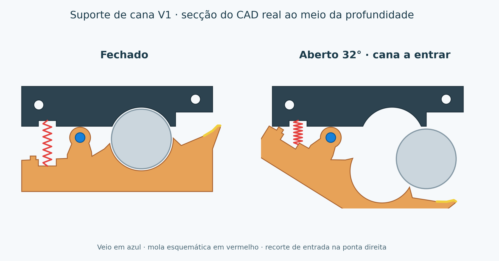

# Suporte de cana com mola — protótipo CAD V1

O [3MF de dois pratos](../../downloads/suporte-cana-mola-v1-A1-PETG-2-pratos.3mf)
abre no Bambu Studio. O prato 1 contém duas peças curtas para testar o veio e a
mola; o prato 2 contém os braços completos. As peças são o **corpo fixo** e o
**mordente móvel**. A faixa amarela do conceito é a rampa integrada no mordente
para lhe dar resistência; na imagem do CAD está destacada a amarelo. O recorte
no corpo fixo deixa a cana alcançar essa ponta saliente.

O CAD editável é [build_cad.py](build_cad.py). Também estão disponíveis o
[STEP conjunto](suporte-cana-mola-v1-assembly.step) e os STEP individuais.
O STEP é geometria neutra; o script mantém os parâmetros de construção.

## Dimensões e material

| Característica | V1 |
| --- | ---: |
| Envelope das peças montadas | cerca de 70 × 37 × 20 mm |
| Diâmetro máximo de cana usado no CAD | 21 mm, **provisório** |
| Folga radial na cavidade | 0,7 mm |
| Eixo | furo Ø3,3 mm para parafuso M3 |
| Espaço entre orelhas do eixo | 10,8 mm para o mordente de 10 mm |
| Alojamentos da mola | Ø6,3 mm × 2 mm de profundidade |
| Pontos de fixação | 2 furos Ø3,5 mm, cabeça até Ø6,5 mm |
| Material previsto | PETG; perfil Generic PETG da Bambu A1, bico 0,4 mm |

O perfil de impressão tem camada de 0,20 mm, cinco paredes, 35% gyroid e
suportes automáticos apenas onde o fatiador os pede, sobretudo junto às
orelhas do eixo. Não tem brim. A escolha da A1 é provisória até confirmação da
impressora para este projeto; o STEP permite preparar um perfil para outra
máquina.

## Ferragens e montagem

- Parafuso M3 × 20 mm em inox e porca hexagonal M3 normal, com altura até
  2,7 mm. A porca entra no rebaixo da face traseira. Não apertar até bloquear
  o mordente.
- Mola de compressão inox, diâmetro exterior até 6,0 mm, comprimento livre
  próximo de 17 mm e **comprimento sólido até 7,5 mm**. Confirmar também a força
  da mola escolhida: o modelo ainda não fixa uma constante elástica.
- Dois parafusos de fixação inox compatíveis com os furos Ø3,5 mm; o comprimento
  depende da superfície onde o suporte será instalado.

Começar pelo prato 1, retirar os suportes da zona do eixo, encaixar a mola nos
dois alojamentos, introduzir o mordente entre as orelhas e apertar o parafuso
com a porca embutida. Confirmar que o braço abre e regressa livremente antes
de imprimir o prato 2. A remoção da cana faz-se empurrando para cima a
extremidade esquerda do mordente, por baixo da mola, para abrir a boca à direita.

## Verificações realizadas

O [relatório CAD](cad-validation.json) confirma um sólido válido por peça e
nenhuma intersecção entre os braços de 0° a 32°. O
[teste do movimento](motion-validation.json) verificou 135 posições de uma
cana Ø21 mm na passagem pela entrada com o mordente aberto 32°; o batente toca
perto dos 33°. O [relatório Bambu](bambu-validation.json) confirma dois pratos
fatiados sem avisos. O 3MF reabriu no Bambu Studio com quatro objetos, todos
manifold e de uma peça cada. **Ainda não existe teste físico** do encaixe, da
mola, da força de retenção ou da instalação no barco.
