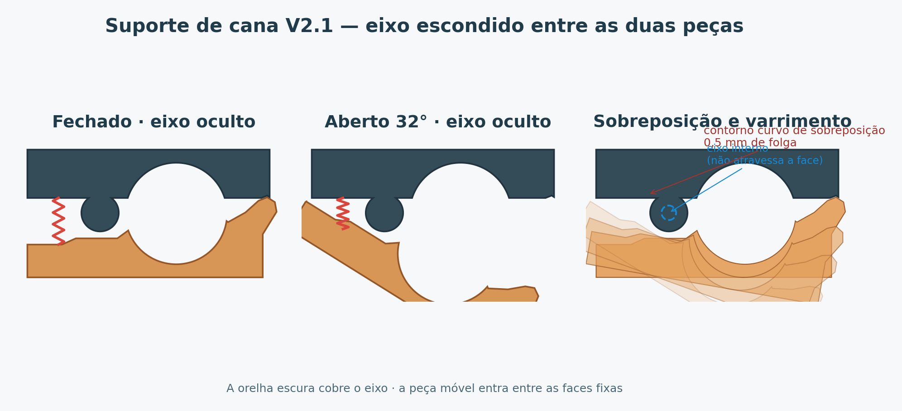

# Suporte de cana com mola — protótipo V2

Protótipo para validar a revisão pedida: mola de compressão apoiada diretamente
entre o corpo fixo e o braço móvel, veio independente à direita da mola e
calcanhar arredondado junto ao veio. O corpo fixo recebe um recorte calculado a
partir do varrimento real do braço entre 0° e 32°, com 0,5 mm de folga.

O script paramétrico é `build_concept.py`. Os STEP e STL aqui gerados são apenas
artefactos de validação, não ficheiros finais de impressão. O diâmetro de cana
de 28 mm, a mola, as ferragens e a fixação ainda precisam de confirmação e
teste físico.

Na revisão V2.1 o eixo deixa de atravessar as faces exteriores. O braço móvel
entra entre duas orelhas da peça fixa e os munhões encaixam em alojamentos
cegos interiores; a orelha exterior forma o contorno curvo de sobreposição e
esconde completamente a articulação na vista exterior.

## Projeto de impressão

O 3MF está organizado em dois pratos. O primeiro contém cupões curtos do eixo
oculto e da mola; deve ser impresso e testado antes do segundo prato, que contém
as peças completas. Perfil provisório: Bambu Lab A1, bico 0,4 mm, Generic PETG,
camada 0,20 mm, cinco paredes, seis camadas superiores e inferiores, 35% gyroid,
suportes automáticos e sem brim.

O encaixe oculto depende da flexibilidade do PETG e ainda não foi testado
fisicamente. Não forçar as peças completas antes de validar os cupões.
