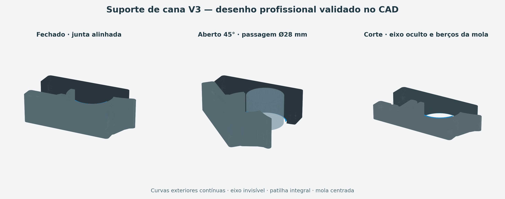

# Suporte de cana V3 — CAD profissional

Esta revisão traduz o conceito aprovado para sólidos paramétricos reais. O
corpo fixo cria duas faces exteriores contínuas que escondem o eixo; o braço
móvel entra entre elas. A mola de compressão fica centrada por dois alojamentos
anulares rebaixados com ilhas centrais ao nível das faces originais.

## Dimensões atuais

| Elemento | V3 |
| --- | ---: |
| Envelope fechado sem patilha | 68 × 42 × 22 mm |
| Comprimento até à ponta da patilha | aproximadamente 79 mm |
| Cana máxima validada digitalmente | Ø28 mm |
| Folga radial na cavidade | 0,8 mm |
| Insertos TPU | 1,2 mm, recuados 3 mm da entrada |
| Abertura máxima | 45° |
| Eixo oculto integrado | Ø4 mm |
| Mola proposta | Ø exterior até 7 mm |
| Comprimento livre proposto | 17 mm |
| Comprimento sólido máximo exigido | calculado na validação após o rebaixo |
| Berços da mola | rebaixo anular Ø8,6/Ø4,2 × 1,2 mm |
| Folga dinâmica entre peças | 0,55 mm |
| Fixação | sem furos ou opção de parafusos nesta revisão |

## Verificação

- Zero intersecção entre as duas peças em 81 posições de 0° a 45°.
- Trajetória contínua encontrada para um cilindro Ø28 mm desde a entrada até ao
  centro da cavidade **com os insertos TPU instalados**, com amostras a cada
  2 mm em X e 0,5 mm em Y.
- Os diâmetros Ø8, Ø16 e Ø22 ficam contidos no envelope já verificado de Ø28 mm.
- STEP individuais e STEP do conjunto exportados a partir dos sólidos válidos.

Estas verificações são geométricas. A força da mola, flexão do encaixe oculto,
desgaste, resistência em ambiente marítimo e contacto com canas reais precisam
de cupão e teste físico antes de preparar a versão final de uso.

A cinemática recalcula no ficheiro `validation.json` a compressão entre fechado
e 45° a partir do fundo dos dois rebaixos. A candidata inicial passa a ter
comprimento livre próximo de 17 mm; comprimento sólido, constante elástica e
pré-carga continuam por validar fisicamente.

## Revisão crítica antes da impressão

- A mola foi aproximada do eixo para reduzir o curso; a primeira geometria
  exigia compressão excessiva.
- Os munhões do eixo receberam pontas cónicas para reduzir a flexão necessária
  durante o encaixe. Mesmo assim, imprimir primeiro o cupão é obrigatório.
- A cavidade estrutural foi aumentada para que Ø28 mm continue a passar com os
  insertos TPU de 1,2 mm instalados. Os insertos terminam 3 mm antes da entrada
  para não estrangular a passagem.
- Foram removidos todos os furos, escareados e encaixes de parafuso. A peça não
  inclui qualquer opção de fixação nesta revisão.
- Cada apoio da mola é agora um rebaixo anular Ø8,6/Ø4,2 × 1,2 mm inserido para
  dentro da peça. A ilha central Ø4,2 termina exatamente ao nível da face base;
  nada fica saliente. A extremidade da mola entra no anel rebaixado e fica
  centrada pela ilha central.
- Não foram abertas bolsas para ímanes nesta revisão. A retenção magnética será
  decidida depois de medir a força da mola, evitando abertura excessivamente
  pesada e ferragens desnecessárias em ambiente marítimo.

## Projeto Bambu Studio

O 3MF tem três pratos: cupão PETG, estrutura completa PETG e dois insertos TPU.
O TPU deve ser alimentado por bobina externa, não pelo AMS Lite. O perfil usa
camada de 0,20 mm, cinco paredes, seis camadas superiores e inferiores, 35%
gyroid, suportes automáticos e sem brim. Os três pratos foram fatiados sem
avisos, mas nenhum encaixe foi ainda testado fisicamente.

## Script Autodesk Fusion 360

A pasta `Fusion360_SuporteCanaMolaV3` contém um script manual para **Scripts
and Add-Ins**. Mantendo a pasta dentro deste diretório, o script cria um novo
documento, importa os quatro STEP como componentes, regista nove parâmetros de
referência e exporta `Documents/SuporteCanaMolaV3_Fusion.f3d` sem substituir um
ficheiro existente. O script foi verificado sintaticamente neste ambiente, mas
não foi executado dentro do Fusion desktop; essa validação continua pendente.
